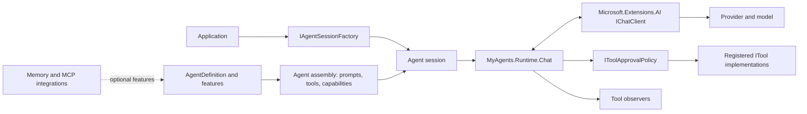
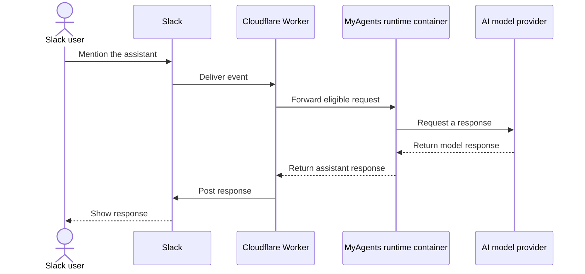

<p align="center">
  
</p>

# MyAgents Community

**Build modular, tool-using AI agents with .NET 10.**

[](https://github.com/OmniTechSolutionsCA/MyAgents-Community/actions/workflows/community-validation.yml)
[](https://github.com/OmniTechSolutionsCA/MyAgents-Community/pulls)
[](#getting-started)
[](LICENSE)
[](https://github.com/OmniTechSolutionsCA/MyAgents-Community/releases)
[](https://www.nuget.org/packages/MyAgents.Core/)
[](#project-status)

**Explore:** [Quick start](#getting-started) · [Capabilities](#capabilities) ·
[Architecture](#architecture) · [Packages](#packages) · [Examples & Samples](#examples) ·
[Real-world deployment](#real-world-deployment-example) · [Contributing](CONTRIBUTING.md) · [Security](SECURITY.md)

MyAgents Community is a modular, high-performance, and provider-neutral agent
runtime for .NET 10. Connect any AI model through Microsoft.Extensions.AI's
`IChatClient`, compose agent behaviors from reusable features, and execute tool
invocations with NativeAOT safety, durable restart recovery, and hybrid memory retrieval.

### Quick Example (C#)

```csharp
using Microsoft.Extensions.AI;
using Microsoft.Extensions.DependencyInjection;
using MyAgents.Core;
using MyAgents.Core.Tools;
using MyAgents.Runtime.Chat;

// 1. Configure services with your IChatClient and MyAgents runtime
var services = new ServiceCollection();
services.AddSingleton<IChatClient>(chatClient); // Ollama, OpenAI, Azure, etc.
services.AddMyAgentsChatRuntime();

await using var provider = services.BuildServiceProvider();
var sessionFactory = provider.GetRequiredService<IAgentSessionFactory>();

// 2. Define an agent with prompts and tools
var definition = new AgentDefinition("assistant", [
    AgentFeature.Create(assembly =>
    {
        assembly.Prompts.AddSystem("You are a helpful assistant.");
        assembly.Tools.Add(DelegateTool.Create("get_time", () => DateTimeOffset.UtcNow.ToString("O")));
    })
]);

// 3. Create a session and run turns
await using var session = sessionFactory.CreateSession("session-1", definition);
var turn = await session.InvokeAsync([AgentMessage.FromText("user", "What time is it in UTC?")]);

foreach (var message in turn.Output)
{
    Console.WriteLine(message.Content);
}
```

## Capabilities

- **Bring your own model provider.** Integrate any provider implementing
  Microsoft.Extensions.AI's [`IChatClient`](https://learn.microsoft.com/en-us/dotnet/core/extensions/artificial-intelligence)
  (Ollama, OpenAI, Azure OpenAI, Anthropic, Gemini, local models).
- **Compile-time NativeAOT tools (`MyAgents.Generators`).** Annotate methods with `[AgentTool]`;
  the Roslyn incremental source generator generates compile-time JSON schemas, zero-reflection
  argument binders, and NativeAOT-safe serialization.
- **Durable agent execution (`MyAgents.Runtime.Workers`).** Generic Host worker for leased agent runs,
  at-least-once execution, admission throttling, and transactional SQLite restart recovery
  (`MyAgents.Runtime.Workers.Sqlite`).
- **Hybrid RAG & memory retrieval (`MyAgents.Memory`).** Dense SIMD vector search (`TensorPrimitives.Dot`)
  combined with sparse BM25 lexical ranking via Reciprocal Rank Fusion (RRF), zero-dependency document
  readers (HTML-to-Markdown, Markdown front-matter, JSON, Text), and persistent SQLite/VectorData stores.
- **Safe tool governance & telemetry.** Pluggable `IToolApprovalPolicy`, streaming guardrails,
  circuit breakers, and end-to-end OpenTelemetry distributed tracing across all turns and tool calls.
- **Deterministic testing (`MyAgents.Testing`).** Exercise turn loops, approvals, and workflows
  without connecting to a live model or remote service.

## Architecture



An application creates a session from an agent definition. Its features
contribute prompts, capabilities, and tools; the chat runtime connects the
session to your provider and applies the configured tool policy.

## Packages

| Package | Purpose |
| --- | --- |
| [MyAgents.Core](MyAgents.Core/README.md) | Agent, session, runtime, tool, approval, and result contracts. |
| [MyAgents.Agents](MyAgents.Agents/README.md) | Reusable features for prompts, tools, model selection, and observations. |
| [MyAgents.Runtime.Chat](MyAgents.Runtime.Chat/README.md) | In-process chat and tool execution over any `IChatClient` provider. |
| [MyAgents.Runtime.Workers](MyAgents.Runtime.Workers/README.md) | Optional Generic Host worker for durable agent runs and workflow handlers. |
| [MyAgents.Runtime.Workers.Sqlite](MyAgents.Runtime.Workers.Sqlite/README.md) | Single-machine SQLite persistence adapter for durable agent runs. |
| [MyAgents.Memory](MyAgents.Memory/README.md) | Memory abstractions, hybrid dense vector + BM25 retrieval, document ingestion, and SQLite / VectorData persistence. |
| [MyAgents.Mcp](MyAgents.Mcp/README.md) | Adapters for applications using the .NET Model Context Protocol library. |
| [MyAgents.Testing](MyAgents.Testing/README.md) | Deterministic test doubles for agents and runtimes. |
| [MyAgents.Generators](MyAgents.Generators/README.md) | Source generator for `[AgentTool]`: compile-time `ITool` wrappers with JSON schemas and NativeAOT-safe binding. Installed automatically with any package reference. |

Bring your own provider-specific `IChatClient`. The Community packages do not
include a model provider, hosted service, or vendor credentials.

All packages are published on
[NuGet.org](https://www.nuget.org/profiles/OmniTechSolutionsCA) with symbols
(`snupkg`), Source Link, and deterministic builds.

## Getting started

### Install from NuGet

The fastest way to try MyAgents is to add the packages to an existing .NET 10
project:

```powershell
dotnet add package MyAgents.Core
dotnet add package MyAgents.Agents
dotnet add package MyAgents.Runtime.Chat
# Optional:
dotnet add package MyAgents.Runtime.Workers
dotnet add package MyAgents.Runtime.Workers.Sqlite
dotnet add package MyAgents.Memory
dotnet add package MyAgents.Mcp
dotnet add package MyAgents.Testing
```

`MyAgents.Generators` is a source-generator/analyzer package — add it when you
use `[AgentTool]`:

```powershell
dotnet add package MyAgents.Generators
```

### Requirements

- .NET 10 SDK

### Build and test from source

Clone the repository, then run these commands from its root:

```powershell
git clone https://github.com/OmniTechSolutionsCA/MyAgents-Community.git
cd MyAgents-Community
dotnet restore MyAgents.Community.slnx
dotnet build MyAgents.Community.slnx --no-restore -c Release
dotnet test MyAgents.Community.slnx --no-build -c Release
```

### Run a chat turn

The [ChatWithTools sample](community/samples/ChatWithTools/README.md) connects
to Ollama or an OpenAI-compatible provider and registers a read-only UTC clock
tool. To use Ollama, start it, pull a tool-capable model, and run the sample
from the repository root:

```sh
ollama pull llama3.2
dotnet run --project community/samples/ChatWithTools/ChatWithTools.csproj
```

The sample prints the tool call and model response. Its README covers model
storage, provider configuration, and troubleshooting.

### Tool approval

Tool calls pass through MyAgents' approval and observation pipeline. If no
approval policy is registered, calls are allowed by default. Register an
explicit policy before enabling tools that can change data or perform other
sensitive actions.

## Examples & Samples

The repository includes runnable console samples demonstrating core capabilities:

- **[ChatWithTools](community/samples/ChatWithTools/README.md)**: Connects to Ollama or OpenAI-compatible
  endpoints, registers an in-process tool, and executes model-driven tool loops.
- **[NativeAotTools](community/samples/NativeAotTools/README.md)**: Demonstrates compile-time `[AgentTool]`
  generation and NativeAOT compilation (`dotnet publish -c Release`) with zero reflection.
- **[DurableAgentRuns](community/samples/DurableAgentRuns/README.md)**: Demonstrates restart recovery,
  leased execution, and state persistence using the SQLite worker adapter.
- **[Community Tests](community/tests/MyAgents.Community.Tests/)**: Exhaustive automated tests exercising
  turns, approvals, circuit breakers, and hybrid retrieval with deterministic doubles.

## Real-world deployment example

Omni Technology Solutions uses a MyAgents assistant internally in Slack. The sequence
below illustrates how the self-hosted MyAgents runtime container powers conversational turns
and tool calls behind an edge ingress worker:



This represents Omni's active internal deployment. Its Slack integration and containerized runtime
are maintained separately from the open-source Community packages in this repository.

## Community scope

This edition provides the core contracts, feature composition, in-process chat
and tool runtime, optional durable-run workers and local SQLite persistence,
memory and MCP integrations, and test helpers. Omni's internal Slack deployment
is maintained separately from this Community repository.

## Project status

MyAgents Community is at **General Availability (GA) 1.0.0** with full semantic versioning
and backward-compatibility commitments. All packages are published to
[NuGet.org](https://www.nuget.org/profiles/OmniTechSolutionsCA) with symbol packages
(`snupkg`), Source Link, and deterministic builds.

### Build and test checks

The Community validation workflow is configured to restore, build, test, and
pack the Community solution for pull requests and `main`. Its badge tracks
`main`; open a pull request's **Checks** tab for that change's results. GitHub
may restrict access to workflow badges in private repositories. For local checks, see
[CONTRIBUTING.md](CONTRIBUTING.md#local-validation).

## Contributing and support

- Read [CONTRIBUTING.md](CONTRIBUTING.md) before proposing changes.
- Use the repository's issue forms for bugs, questions, and feature requests.
- Report suspected vulnerabilities using [SECURITY.md](SECURITY.md), not a
  public issue.
- Review [SUPPORT.md](SUPPORT.md) for current support expectations.
- See [CHANGELOG.md](CHANGELOG.md) for release notes.

## License

MyAgents Community is licensed under the MIT License. See [LICENSE](LICENSE)
and the license file in each package directory.
