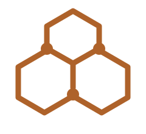
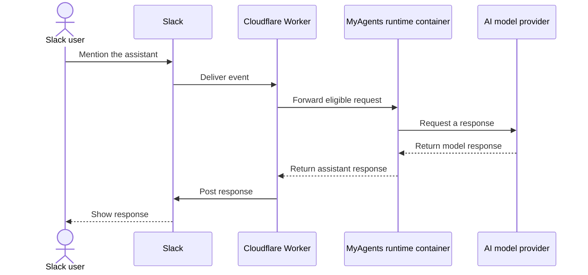
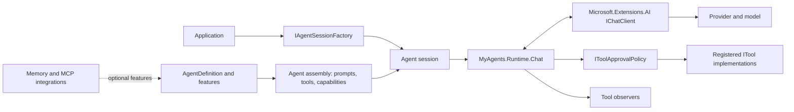

<p align="center">
  
</p>

# MyAgents Community

**Build modular, tool-using AI agents with .NET 10.**

[](https://github.com/OmniTechSolutionsCA/MyAgents-Community/actions/workflows/community-validation.yml)
[](https://github.com/OmniTechSolutionsCA/MyAgents-Community/pulls)
[](#getting-started)
[](LICENSE)
[](https://github.com/OmniTechSolutionsCA/MyAgents-Community/releases)
[](https://www.nuget.org/packages/MyAgents.Core/)
[](#project-status)

**Explore:** [Capabilities](#capabilities) · [Architecture](#architecture) ·
[Packages](#packages) · [Quick start](#getting-started) · [Examples](#examples) ·
[Contributing](CONTRIBUTING.md) · [Security](SECURITY.md)

MyAgents Community is a provider-neutral foundation for self-hosted agent
applications. Connect a model through Microsoft.Extensions.AI's `IChatClient`,
compose agent behavior from reusable features, and let the MyAgents runtime
manage chat turns and registered tool calls.

Omni Technology Solutions also uses a MyAgents assistant internally in Slack.
That Slack integration is separate from the Community packages in this repository.

### Internal Slack example

The following diagram illustrates the architecture and message flow of Omni's internal Slack assistant deployment:



This represents Omni's active internal deployment. Its Slack integration and
containerized runtime are maintained separately from the Community packages in this repository.

> [!WARNING]
> This is a preview. APIs and package versions may change. NuGet packages are
> published as prerelease (`0.2.0-preview.*`) — pin exact versions.

## Capabilities

- **Bring your own model provider.** Use any provider integration that
  implements Microsoft.Extensions.AI's [`IChatClient`](https://learn.microsoft.com/en-us/dotnet/core/extensions/artificial-intelligence).
- **Compose agent behavior.** Add prompts, tools, model capabilities, memory,
  and observations as reusable features.
- **Run chat and tools in process.** `MyAgents.Runtime.Chat` manages the
  model/tool loop and returns turn results and token usage.
- **Extend applications.** Optional Community packages add memory abstractions
  and .NET Model Context Protocol adapters.
- **Test without live services.** Use deterministic doubles to exercise agent
  behavior without a model provider or remote service.

## Architecture



An application creates a session from an agent definition. Its features
contribute prompts, capabilities, and tools; the chat runtime connects the
session to your provider and applies the configured tool policy.

## Packages

| Package | Purpose |
| --- | --- |
| [MyAgents.Core](MyAgents.Core/README.md) | Agent, session, runtime, tool, approval, and result contracts. |
| [MyAgents.Agents](MyAgents.Agents/README.md) | Reusable features for prompts, tools, model selection, and observations. |
| [MyAgents.Runtime.Chat](MyAgents.Runtime.Chat/README.md) | In-process chat and tool execution over any `IChatClient` provider. |
| [MyAgents.Memory](MyAgents.Memory/README.md) | Memory abstractions and local in-memory integration. |
| [MyAgents.Mcp](MyAgents.Mcp/README.md) | Adapters for applications using the .NET Model Context Protocol library. |
| [MyAgents.Testing](MyAgents.Testing/README.md) | Deterministic test doubles for agents and runtimes. |
| [MyAgents.Generators](MyAgents.Generators/README.md) | Source generator for `[AgentTool]`: compile-time `ITool` wrappers with JSON schemas and NativeAOT-safe binding. Installed automatically with any package reference. |

Bring your own provider-specific `IChatClient`. The Community packages do not
include a model provider, hosted service, or vendor credentials.

All packages are published on
[NuGet.org](https://www.nuget.org/profiles/OmniTechSolutionsCA) with symbols
(`snupkg`), Source Link, and deterministic builds.

## Getting started

### Install from NuGet

The fastest way to try MyAgents is to add the packages to an existing .NET 10
project:

```powershell
dotnet add package MyAgents.Core --prerelease
dotnet add package MyAgents.Agents --prerelease
dotnet add package MyAgents.Runtime.Chat --prerelease
# Optional:
dotnet add package MyAgents.Memory --prerelease
dotnet add package MyAgents.Mcp --prerelease
dotnet add package MyAgents.Testing --prerelease
```

`MyAgents.Generators` is a source-generator/analyzer package — add it when you
use `[AgentTool]`:

```powershell
dotnet add package MyAgents.Generators --prerelease
```

### Requirements

- .NET 10 SDK
- PowerShell 7 for the Community boundary check and export scripts

### Build and test from source

Clone the repository, then run these commands from its root:

```powershell
git clone https://github.com/OmniTechSolutionsCA/MyAgents-Community.git
cd MyAgents-Community
pwsh -File community/eng/check-open-core-boundary.ps1
dotnet restore MyAgents.Community.slnx
dotnet build MyAgents.Community.slnx --no-restore -c Release
dotnet test MyAgents.Community.slnx --no-build -c Release
```

### Run a chat turn

The [ChatWithTools sample](community/samples/ChatWithTools/README.md) connects
to Ollama or an OpenAI-compatible provider and registers a read-only UTC clock
tool. To use Ollama, start it, pull a tool-capable model, and run the sample
from the repository root:

```sh
ollama pull llama3.2
dotnet run --project community/samples/ChatWithTools/ChatWithTools.csproj
```

The sample prints the tool call and model response. Its README covers model
storage, provider configuration, and troubleshooting.

### Tool approval

Tool calls pass through MyAgents' approval and observation pipeline. If no
approval policy is registered, calls are allowed by default. Register an
explicit policy before enabling tools that can change data or perform other
sensitive actions.

## Examples

The [chat and tool sample](community/samples/ChatWithTools/README.md) is a
complete console application. The [chat runtime guide](MyAgents.Runtime.Chat/README.md)
describes provider registration and runtime behavior. The
[Community tests](community/tests/MyAgents.Community.Tests/) exercise chat
turns, tool calls, and approvals without contacting a live model.

## Community scope

This edition provides the core contracts, feature composition, in-process chat
and tool runtime, memory and MCP integrations, and test helpers. Omni's internal
Slack deployment is maintained separately from this Community repository.

## Project status

The Community edition is a preview. It has no stable release or compatibility
guarantee yet. All packages are published to
[NuGet.org](https://www.nuget.org/profiles/OmniTechSolutionsCA) as prerelease
versions.

### Build and test checks

The Community validation workflow is configured to restore, build, test, and
pack the Community solution for pull requests and `main`. Its badge tracks
`main`; open a pull request's **Checks** tab for that change's results. GitHub
may restrict access to workflow badges in private repositories. For local checks, see
[CONTRIBUTING.md](CONTRIBUTING.md#local-validation).

## Contributing and support

- Read [CONTRIBUTING.md](CONTRIBUTING.md) before proposing changes.
- Use the repository's issue forms for bugs, questions, and feature requests.
- Report suspected vulnerabilities using [SECURITY.md](SECURITY.md), not a
  public issue.
- Review [SUPPORT.md](SUPPORT.md) for current support expectations.
- See [CHANGELOG.md](CHANGELOG.md) for release notes.

## License

MyAgents Community is licensed under the MIT License. See [LICENSE](LICENSE)
and the license file in each package directory.
