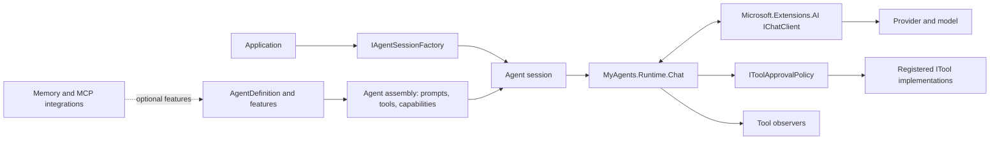

# Architecture

MyAgents Community separates agent definitions from provider integration, execution, and state persistence.

## Core Abstractions

### AgentDefinition & Features
An agent is defined declaratively using `AgentDefinition` composed of one or more `IAgentFeature` instances. Features contribute:
- **System Prompts**: Contextual prompts, role definitions, and guidelines.
- **Tools**: In-process delegate tools, generated `[AgentTool]` wrappers, or MCP tool proxies.
- **Capabilities**: Structured output schemas, streaming controls, and model options.

### IAgentSession & Factory
`IAgentSessionFactory` builds an executable `IAgentSession` bound to an isolated session identifier and conversation state. The session manages chat history and exposes `InvokeAsync` for conversational turns.

### ChatClientRuntime
The chat runtime (`MyAgents.Runtime.Chat`) manages the interaction with `IChatClient`:
- Dispatches model requests.
- Parses tool calls requested by the model.
- Evaluates configured `IToolApprovalPolicy` policies.
- Invokes approved tools and feeds results back to the model turn loop until completion.
- Streams token deltas incrementally while preserving whole-turn guardrails.
