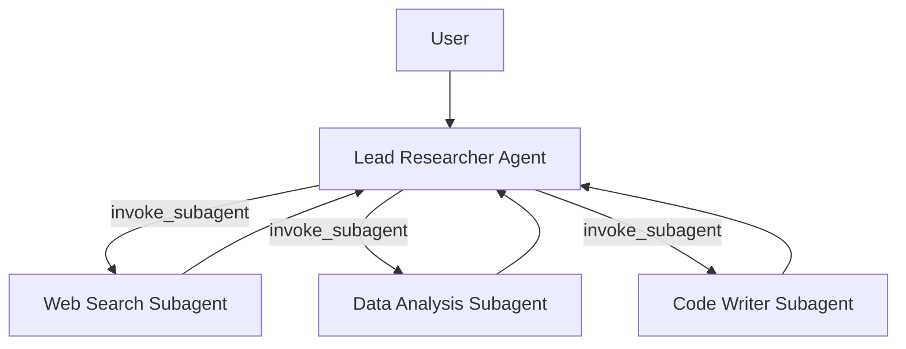

# Multi-Agent Teams & Subagents

Complex workflows often require dividing responsibilities across specialized agents. The `MyAgents.Agents` package provides hierarchical subagent dispatching, group chat coordination, and multi-model cost routing.

## 1. Hierarchical Subagent Dispatching

A parent orchestrator agent can delegate tasks to specialized child subagents using `HierarchicalSubagentDispatcher`:



### Configuring Subagents

```csharp
using MyAgents.Agents.Orchestration;

var services = new ServiceCollection();

// Register subagent definitions
services.AddSubagent("web-searcher", searcherDefinition);
services.AddSubagent("data-analyst", analystDefinition);
services.AddSubagent("code-writer", coderDefinition);

// Add dispatcher and parent orchestration feature
services.AddHierarchicalSubagents(options =>
{
    options.MaxSubagentTurns = 5;
    options.MaxParallelSubagents = 3;
});
```

The parent agent automatically receives an `invoke_subagent` tool to spawn child tasks and collect their answers.

---

## 2. Multi-Agent Group Chat

When multiple agents need to converse and collaborate in a shared thread, use `GroupChat` or `SelectorGroupChat`:

```csharp
using MyAgents.Agents;

var group = new SelectorGroupChat(
    agents: [researcherAgent, reviewerAgent, writerAgent],
    managerChatClient: coordinatorChatClient,
    maxTurns: 10
);

var transcript = await group.RunAsync("Produce a technical brief on NativeAOT in .NET 10.");
```

---

## 3. Intelligent Model Cost Routing

Large frontier models (e.g., GPT-4o, Claude 3.5 Sonnet) are expensive for routine classification or simple formatting tasks. Use `MultiModelRoutingChatClient` to route queries dynamically based on complexity, token budget, or prompt classification:

```csharp
using MyAgents.Agents.Routing;

services.AddMultiModelRouting(options =>
{
    // Fast, inexpensive tier for simple turns
    options.RegisterTier(ModelTier.Economy, cheapClient, new ModelPricing(InputPerMillion: 0.15m, OutputPerMillion: 0.60m));

    // Reasoning tier for complex tool calling and analysis
    options.RegisterTier(ModelTier.Reasoning, frontierClient, new ModelPricing(InputPerMillion: 5.00m, OutputPerMillion: 15.00m));

    options.DailyCostBudgetUsd = 25.00m;
});
```
