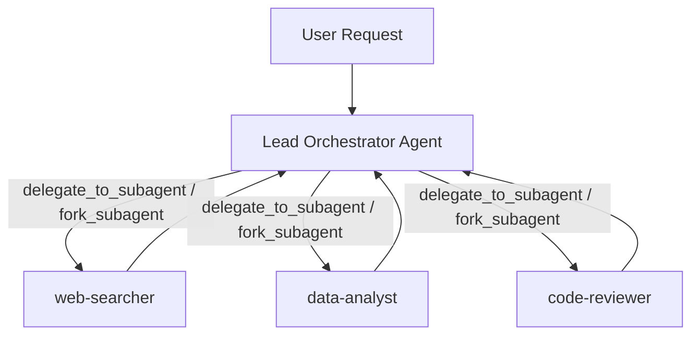

# Multi-Agent Teams, Subagents & Cost Routing

Complex tasks often benefit from dividing responsibilities across specialized agents. `MyAgents.Agents` provides hierarchical subagent delegation, multi-agent group chats, capability routing, inter-agent messaging channels, and multi-model cost routing.

## 1. Hierarchical Subagent Dispatching

A parent orchestrator agent can delegate subtasks synchronously (`delegate_to_subagent`) or fork background tasks (`fork_subagent` + `get_subagent_task_status`) using `HierarchicalSubagentDispatcher` and `SubagentDelegationFeature`:



### Configuring Subagents in Dependency Injection

```csharp
using Microsoft.Extensions.DependencyInjection;
using MyAgents.Agents;
using MyAgents.Core;

var services = new ServiceCollection();
services.AddMyAgentsChatRuntime();

// Register child subagents and SubagentDelegationFeature
services.AddHierarchicalSubagents(builder =>
{
    builder
        .AddSubagent(new AgentDefinition("web-searcher", [searchTools], "Finds up-to-date documentation"))
        .AddSubagent(new AgentDefinition("data-analyst", [sqlTools], "Analyzes metrics and SQL datasets"))
        .AddSubagent(new AgentDefinition("code-reviewer", [reviewTools], "Reviews C# code for bugs"))
        .ConfigureOptions(options =>
        {
            options.MaxDelegationDepth = 3;
            options.DefaultTimeout = TimeSpan.FromMinutes(2);
            options.PrefixSubagentSessionId = true;
        });
});

await using var provider = services.BuildServiceProvider();

// Attach SubagentDelegationFeature to the parent orchestrator agent
var delegationFeature = provider.GetRequiredService<SubagentDelegationFeature>();
var leadAgent = new AgentDefinition("lead-orchestrator", [delegationFeature]);
```

You can also invoke `ISubagentDispatcher` directly from C# code:

```csharp
var dispatcher = provider.GetRequiredService<ISubagentDispatcher>();

// Synchronous delegation
SubagentResult result = await dispatcher.DelegateAsync(
    new SubagentTask(
        TaskId: "task-1",
        TargetAgentName: "data-analyst",
        Instructions: "Summarize Q3 revenue growth."),
    cancellationToken);

// Or background fork
SubagentTaskHandle handle = await dispatcher.ForkAsync(
    new SubagentTask("task-2", "web-searcher", "Check .NET 10 release notes."),
    cancellationToken);
```

---

## 2. Multi-Agent Group Chat (`GroupChat` & `SelectorGroupChat`)

When multiple agents need to collaborate in a shared conversation thread, use `GroupChat` (deterministic C# speaker selection function) or `SelectorGroupChat` (LLM-driven speaker selection):

### Deterministic `GroupChat`

```csharp
using MyAgents.Agents;
using MyAgents.Core;

var options = new GroupChatOptions(
    Agents: [researcherDef, writerDef, reviewerDef],
    MaxTurns: 6,
    Termination: new TextMentionTermination("APPROVED"));

var groupChat = new GroupChat(options, sessionFactory);

GroupChatResult chatResult = await groupChat.RunAsync(
    initialMessages: [AgentMessage.FromText("user", "Draft a migration guide for NativeAOT.")],
    selectionFunc: (history, turnIndex) => options.Agents[turnIndex % options.Agents.Count],
    cancellationToken: cancellationToken);

Console.WriteLine($"Completed in {chatResult.TotalTurns} turns. Last speaker: {chatResult.LastSpeaker}");
```

### LLM-Coordinated `SelectorGroupChat`

```csharp
var selectorOptions = new SelectorGroupChatOptions(
    Agents: [researcherDef, writerDef, reviewerDef],
    SelectorClient: coordinatorChatClient,
    SelectorPrompt: "Select the next agent best suited to advance the conversation.",
    MaxTurns: 8,
    Termination: new TextMentionTermination("FINAL_SIGN_OFF"));

var selectorChat = new SelectorGroupChat(selectorOptions, sessionFactory);
SelectorGroupChatResult result = await selectorChat.RunAsync(
    [AgentMessage.FromText("user", "Produce a security audit report.")],
    cancellationToken);
```

---

## 3. Capability Routing (`CapabilityRouter`)

Use `CapabilityRouter` to classify an incoming task description and route it to the best-matching `AgentDefinition`:

```csharp
var router = new CapabilityRouter(
    chatClient: classifierChatClient,
    agents: [billingAgentDef, technicalSupportDef, salesAgentDef],
    fallbackAgentName: "technical-support");

CapabilityRouterResult route = await router.RouteAsync(
    "My invoice from October shows a duplicate charge.",
    cancellationToken);

Console.WriteLine($"Selected: {route.SelectedAgent.Name} (Reason: {route.Reasoning})");
```

---

## 4. Adaptive Multi-Model Cost Routing (`MultiModelRoutingChatClient`)

Route turns across model tiers (`ModelTier.Economy`, `ModelTier.Standard`, `ModelTier.Advanced`), enforce per-turn or per-session USD/token budgets (`TokenBudgetQuotaException`), and automatically cascade to fallback models on transient failures:

```csharp
using Microsoft.Extensions.DependencyInjection;
using MyAgents.Agents;

services.AddMultiModelRouting(builder =>
{
    builder
        .AddCandidate(
            modelId: "gpt-4o-mini",
            client: miniChatClient,
            tier: ModelTier.Economy,
            pricing: new ModelPricing("gpt-4o-mini", InputCostPerMillionTokens: 0.15m, OutputCostPerMillionTokens: 0.60m),
            maxInputTokens: 128_000)
        .AddCandidate(
            modelId: "gpt-4o",
            client: frontierChatClient,
            tier: ModelTier.Advanced,
            pricing: new ModelPricing("gpt-4o", InputCostPerMillionTokens: 2.50m, OutputCostPerMillionTokens: 10.00m),
            maxInputTokens: 128_000,
            isFallback: true)
        .ConfigureOptions(options =>
        {
            options.EnableFallbackCascade = true;
            options.MaxCostPerTurnUsd = 0.25m;
            options.MaxCostPerSessionUsd = 5.00m;
            options.MaxTokensPerSession = 250_000;
        });
});
```

Inspect real-time token and cost metrics via `ITokenCostTelemetrySink` (`InMemoryTokenCostTelemetrySink`):

```csharp
var costSink = (InMemoryTokenCostTelemetrySink)provider.GetRequiredService<ITokenCostTelemetrySink>();
Console.WriteLine($"Session spend: ${costSink.GetTotalCostUsd("session-1"):F4} ({costSink.GetTotalTokens("session-1")} tokens)");
```
