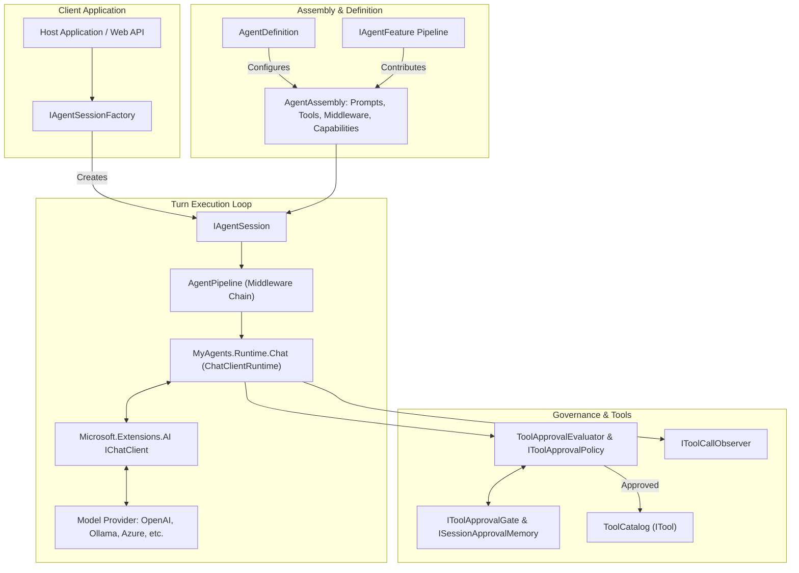
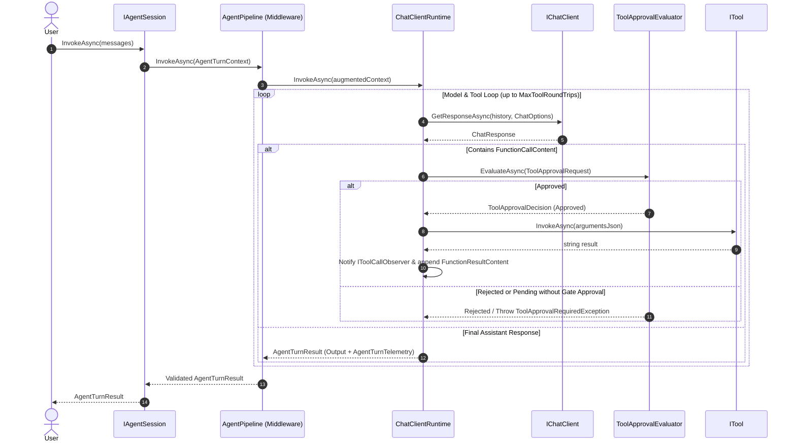

# Architecture & Execution Lifecycle

MyAgents Community is designed with a strict separation of concerns between **agent definitions**, **feature assembly**, **middleware pipelines**, **runtime execution loops**, **tool invocation policies**, and **state persistence**.

## Architecture Overview



---

## Core Abstractions

### 1. `AgentDefinition`
An immutable description of an agent's identity, description, features, and capabilities:

```csharp
using MyAgents.Agents;
using MyAgents.Core;
using MyAgents.Memory;

var definition = new AgentDefinition(
    Name: "financial-analyst",
    Features:
    [
        new PromptRegistryFeature(promptRegistry, "system.analyst"),
        new ToolsFeature(marketDataTool),
        new RetrievalAugmentationFeature(new RetrievalAugmentationOptions("sec-filings")),
        new GuardrailsFeature(),
        new TelemetryFeature()
    ],
    Description: "Analyzes quarterly financial filings with grounded citations.");
```

### 2. `IAgentFeature` & `AgentAssembly`
Features are the primary unit of composition (`Features are composed, not inherited`). When an agent session is created, every feature's `Contribute(AgentAssembly)` or `ContributeAsync(AgentAssembly, CancellationToken)` method populates an `AgentAssembly`:
- **`assembly.Prompts`** (`PromptBuilder`): Appends system instructions injected before model invocation.
- **`assembly.Tools`** (`ToolCatalogBuilder`): Registers `ITool` implementations or delegate functions.
- **`assembly.Pipeline`** (`PipelineBuilder`): Adds `IAgentMiddleware` interceptors around each turn (RAG context augmentation, context window trimming, retries, circuit breakers, structured output validation, guardrails, telemetry).
- **`assembly.ToolObservers`**: Attaches `IToolCallObserver` listeners for pre/post tool call auditing.
- **`assembly.Capabilities`**: Advertises `AgentCapabilities` (`Tools`, `Streaming`, `StructuredOutput`, `Memory`, `MultiModal`, `Telemetry`, `Channel`, `Workflow`) or `AgentModelCapability`.
- **`assembly.RegisterSessionService<T>(service)`**: Registers session-scoped services accessible via `context.Services`.

### 3. `IAgentSessionFactory` & `IAgentSession`
`IAgentSessionFactory` (implemented by `DefaultAgentSessionFactory`) is registered in Dependency Injection via `services.AddMyAgentsChatRuntime()` or `services.AddMyAgents(...)`.
- Calling `factory.CreateSession(sessionId, definition)` or `await factory.CreateSessionAsync(sessionId, definition, ct)` runs the feature assembly phase and builds the middleware pipeline.
- Each `IAgentSession` manages isolated conversation state and implements `IAsyncDisposable` to clean up session-owned resources (such as MCP connections) when disposed.

---

## The Turn Execution Lifecycle

When `session.InvokeAsync(messages)` or `session.InvokeStreamingAsync(messages)` is called:



1. **Middleware Pipeline Pre-Processing**: Registered `IAgentMiddleware` components execute in order—trimming the context window (`ContextWindowMiddleware`), injecting hybrid RAG citations (`RetrievalAugmentationMiddleware`), setting structured output schemas (`StructuredOutputMiddleware<T>`), and starting OpenTelemetry activities (`TelemetryMiddleware`).
2. **Model Request**: `ChatClientRuntime` converts `AgentMessage` records (including multi-modal `ContentParts`) and `ITool` declarations into `Microsoft.Extensions.AI` primitives and invokes `IChatClient`.
3. **Tool Call Detection & Parallel Execution**: If the model requests one or more tool calls, the runtime evaluates them (supporting concurrent tool calls up to `ChatClientRuntimeOptions.MaxParallelToolCalls`).
4. **Approval & Observation**: `ToolApprovalEvaluator` checks `ISessionApprovalMemory`, `IToolApprovalPolicy`, and `IToolApprovalGate`, recording an audit trail to `IToolApprovalAuditSink`. Approved calls notify `IToolCallObserver.OnToolCallingAsync`, execute `ITool.InvokeAsync`, and notify `OnToolCalledAsync`.
5. **Post-Turn Validation**: Output flows back through the middleware pipeline—verifying citation grounding (`CitationGrounder`), validating JSON schemas (`StructuredOutputMiddleware<T>`), and checking safety policies (`GuardrailMiddleware`)—before returning the final `AgentTurnResult`.
