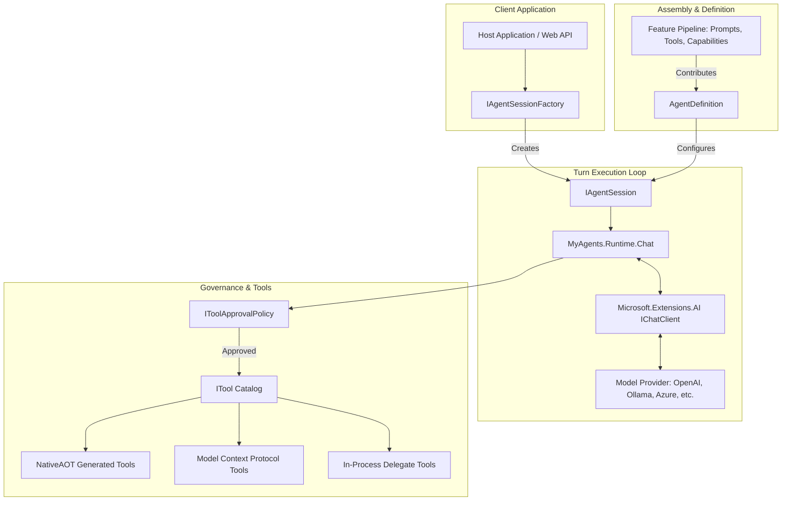
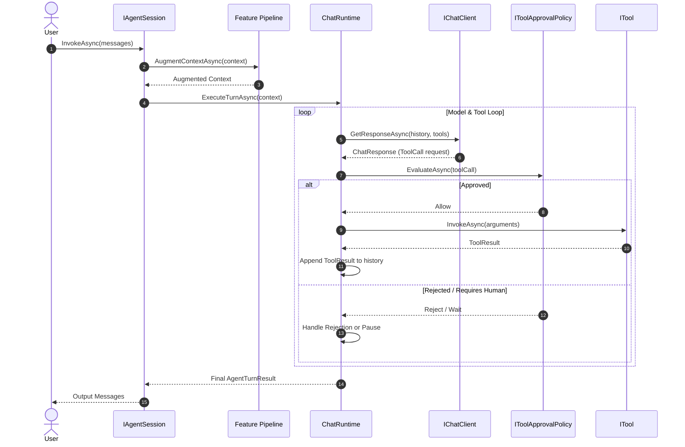

# Architecture & Execution Lifecycle

MyAgents Community is designed with a strict separation of concerns between **agent definitions**, **runtime execution loops**, **tool invocation policies**, and **state persistence**.

## Architecture Overview



---

## Core Abstractions

### 1. `AgentDefinition`
An immutable description of an agent's identity, metadata, and capabilities. Built modularly using `IAgentFeature`:

```csharp
var definition = new AgentDefinition("financial-analyst", [
    new PromptRegistryFeature(...),
    new ToolApprovalFeature(policy),
    new RetrievalAugmentationFeature(retriever)
]);
```

### 2. `IAgentFeature`
Features are the primary unit of extensibility. When an agent session initializes, every feature participates in an assembly phase to contribute:
- **System Prompts**: Injected into the prompt chain before model invocation.
- **Tools**: Registers available functions (`ITool`) with JSON schema descriptions.
- **Context Augmentation**: Intercepts turns before/after model requests (e.g. RAG, guardrails, memory).
- **Tool Interception**: Wraps tool executions to enforce policies, caching, or rate limits.

### 3. `IAgentSessionFactory` & `IAgentSession`
`IAgentSessionFactory` is registered in Microsoft Dependency Injection and manufactures `IAgentSession` instances.
- Each `IAgentSession` represents an active conversation.
- Maintains isolated message history.
- Disposes resources cleanly when the conversation finishes (`IAsyncDisposable`).

---

## The Turn Execution Lifecycle

When `session.InvokeAsync(messages)` or `session.InvokeStreamingAsync(messages)` is called:



1. **Context Augmentation**: Any registered features (e.g. memory retrieval, guardrails) augment input messages.
2. **Model Request**: The `ChatRuntime` serializes messages and tool schemas to `IChatClient`.
3. **Tool Call Detection**: If the model requests one or more tool calls, the runtime parses the request.
4. **Approval Check**: Before executing any tool, `IToolApprovalPolicy` verifies the tool name and arguments.
5. **Tool Execution**: Approved tools execute asynchronously with cancellation token support.
6. **Result Feedback**: Tool outputs are formatted as tool messages and sent back to the model.
7. **Completion**: When the model finishes generating its final response, the turn completes and returns `AgentTurnResult`.
