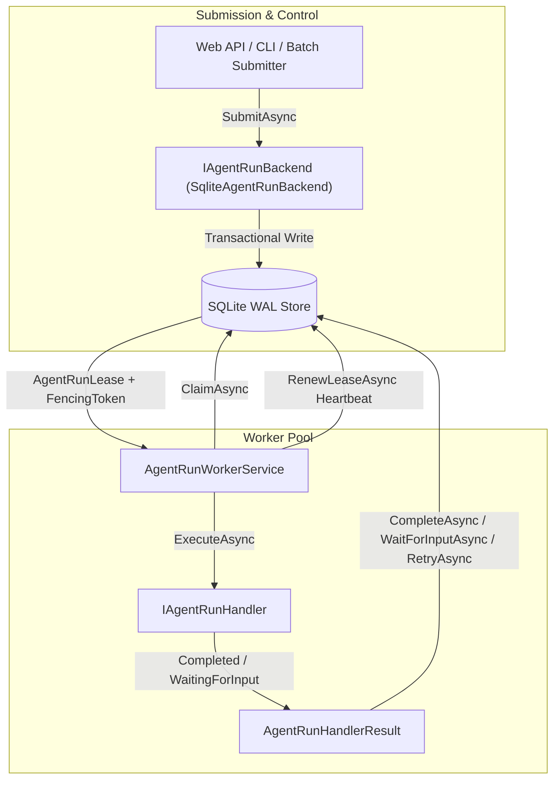

# Durable Agent Runs & Batch Execution

`MyAgents.Runtime.Workers` and `MyAgents.Runtime.Workers.Sqlite` provide a crash-resilient, lease-based background execution engine for long-running agent workloads, batch evaluations, and stateful workflows.

## Why Durable Runs?

In production, agents often execute multi-minute tasks such as crawling documentation, processing batch datasets, or waiting on human approvals. Running these inside an HTTP request is fragile:
- Container restarts or deployments terminate in-flight turns.
- Client retries cause duplicate agent executions and wasted token spend.
- Traffic spikes can overwhelm provider rate limits without scope-based admission throttling.

Durable Runs decouple **submission** from **execution** using a persistent `IAgentRunBackend`, fencing tokens, lease heartbeats, and automatic crash recovery.

---

## Architecture



---

## 1. Configuring the Durable Worker Host

Register the SQLite backend, your `IAgentRunHandler` implementations, and the Generic Host worker service:

```csharp
using Microsoft.Extensions.DependencyInjection;
using Microsoft.Extensions.Hosting;
using MyAgents.Core.Execution;
using MyAgents.Runtime.Workers;
using MyAgents.Runtime.Workers.Sqlite;

var builder = Host.CreateApplicationBuilder();

// 1. Register SQLite persistence backend with optional scope throttling
builder.Services.AddSingleton<IAgentRunBackend>(_ =>
    new SqliteAgentRunBackend(
        databasePath: "agent-runs.db",
        options: new AgentRunBackendOptions
        {
            MaxLeasedRunsPerScope = 4,
            MaxOutstandingRunsPerScope = 100
        }));

// 2. Register your run handler(s)
builder.Services.AddSingleton<IAgentRunHandler, DataProcessingAgentHandler>();

// 3. Register the hosted worker service
builder.Services.AddMyAgentsRunWorker(options =>
{
    options.WorkerId = Environment.MachineName;
    options.MaxConcurrentRuns = 4;
    options.IdlePollInterval = TimeSpan.FromMilliseconds(250);
    options.LeaseDuration = TimeSpan.FromSeconds(30);
    options.LeaseRenewalInterval = TimeSpan.FromSeconds(10);
    options.BaseRetryDelay = TimeSpan.FromSeconds(2);
    options.MaximumRetryDelay = TimeSpan.FromMinutes(5);
});

using var host = builder.Build();
await host.RunAsync();
```

---

## 2. Implementing `IAgentRunHandler`

Each `IAgentRunHandler` declares a stable `HandlerId` and implements `ExecuteAsync(AgentRunContext, CancellationToken)`:

```csharp
using MyAgents.Core;
using MyAgents.Core.Execution;

public sealed class DataProcessingAgentHandler : IAgentRunHandler
{
    public const string StableHandlerId = "data-processing";

    private readonly IAgentSessionFactory _sessionFactory;
    private readonly AgentDefinition _definition;

    public DataProcessingAgentHandler(
        IAgentSessionFactory sessionFactory,
        AgentDefinition definition)
    {
        _sessionFactory = sessionFactory;
        _definition = definition;
    }

    public string HandlerId => StableHandlerId;

    public async ValueTask<AgentRunHandlerResult> ExecuteAsync(
        AgentRunContext context,
        CancellationToken cancellationToken = default)
    {
        // Optionally inspect or save intermediate checkpoints during multi-step work
        if (context.CheckpointJson is null)
        {
            await context.SaveCheckpointAsync("""{"stage":"started"}""", cancellationToken);
        }

        await using var session = _sessionFactory.CreateSession(context.RunId, _definition);
        var turn = await session.InvokeAsync(
            [AgentMessage.FromText("user", context.InputJson)],
            cancellationToken);

        var output = turn.Output.LastOrDefault()?.Content ?? string.Empty;
        return AgentRunHandlerResult.Completed(output);
    }
}
```

### Pausing a Run for External Input (`WaitingForInput`)

A handler can pause a durable run and release its worker slot while waiting for a human or webhook signal:

```csharp
// Inside ExecuteAsync:
if (context.ResumeInputJson is null)
{
    return AgentRunHandlerResult.WaitingForInput(
        checkpointJson: """{"step":"awaiting-manager-signoff"}""",
        pendingInputDescription: "Approve Q3 audit report publication?");
}

// Later, when the external signal arrives, resume the run on the backend:
await backend.ResumeAsync(runId, resumeInputJson: """{"approved":true}""", cancellationToken);
```

---

## 3. Submitting Runs with Idempotency & Scope Throttling

```csharp
var backend = serviceProvider.GetRequiredService<IAgentRunBackend>();

var request = new AgentRunRequest(
    HandlerId: DataProcessingAgentHandler.StableHandlerId,
    InputJson: """{"dataset": "sales-q3", "action": "audit"}""",
    IdempotencyKey: "sales-q3-audit-2026",
    ScopeKey: "tenant-acme",
    Deadline: DateTimeOffset.UtcNow.AddMinutes(15),
    MaxAttempts: 3);

AgentRunSubmission submission = await backend.SubmitAsync(request, cancellationToken);

if (submission.WasDeduplicated)
{
    Console.WriteLine($"Duplicate request deduplicated. Existing RunId: {submission.RunId}");
}
else
{
    Console.WriteLine($"Enqueued new RunId: {submission.RunId}");
}
```

---

## 4. Batch Submission, Reporting & Cancellation

`MyAgents.Runtime.Workers` includes `AgentRunBatchSubmitter`, `AgentRunBatchReporter`, and `AgentRunBatchController` for managing large batches of durable runs:

```csharp
using MyAgents.Core.Execution;
using MyAgents.Runtime.Workers;

var submitter = new AgentRunBatchSubmitter(backend);
var reporter = new AgentRunBatchReporter((IAgentRunBatchCatalog)backend);
var controller = new AgentRunBatchController((IAgentRunBatchController)backend);

// 1. Stream batch cases into the backend
async IAsyncEnumerable<AgentRunBatchCase> GenerateCasesAsync()
{
    yield return new AgentRunBatchCase("case-1", new AgentRunRequest("data-processing", """{"id":1}"""));
    yield return new AgentRunBatchCase("case-2", new AgentRunRequest("data-processing", """{"id":2}"""));
    await Task.CompletedTask;
}

await foreach (var sub in submitter.SubmitAsync("batch-2026-11", GenerateCasesAsync(), cancellationToken))
{
    Console.WriteLine($"Submitted run {sub.RunId} for batch-2026-11");
}

// 2. Query aggregated batch progress and success rate
AgentRunBatchSummary summary = await reporter.GetSummaryAsync("batch-2026-11", cancellationToken);
Console.WriteLine($"Total: {summary.RunCount}, Succeeded: {summary.SucceededCount}, Pending: {summary.PendingCount}, Complete: {summary.IsComplete}");

// 3. Cancel remaining runs in the batch if needed
int cancelled = await controller.CancelAsync("batch-2026-11", cancellationToken);
```
