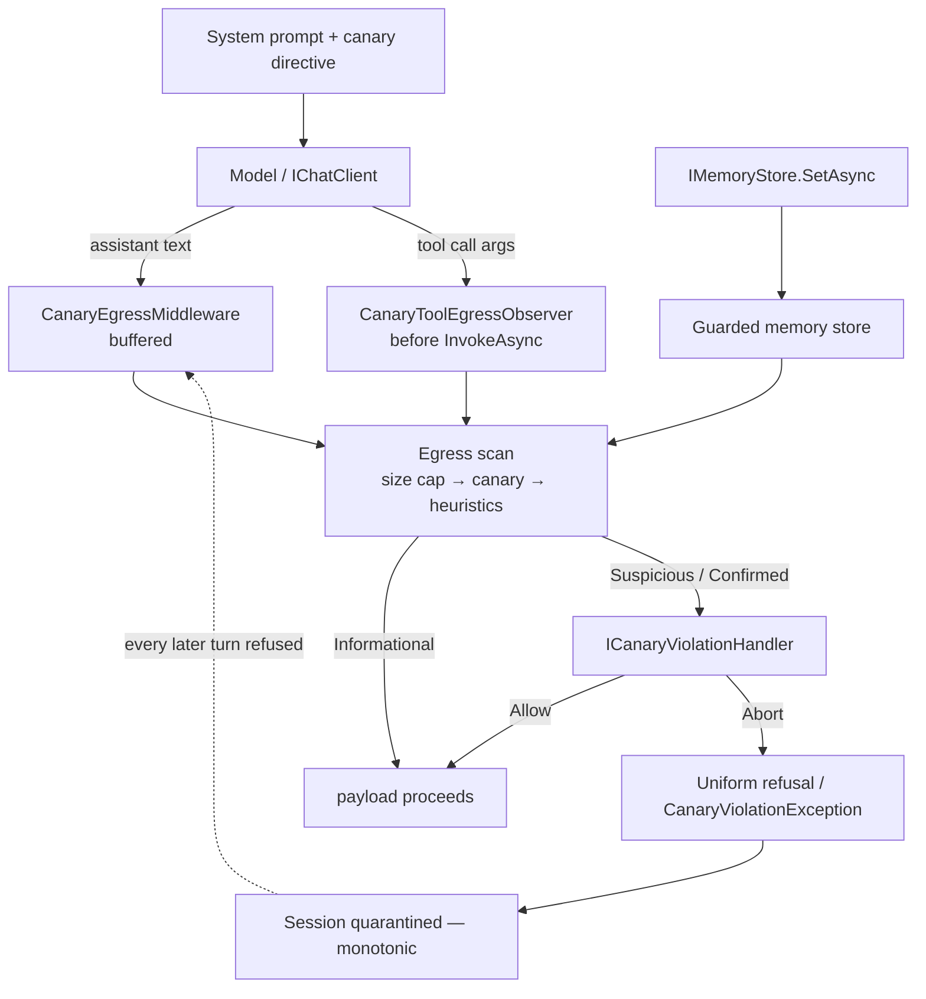

# Canary Egress Defense

Most agent safety in MyAgents is **inbound** (`IGuardrailPolicy` inspects what the model produced) or **human oversight** (`IToolApprovalGate` decides whether a tool may run). Neither answers the question an attacker actually cares about: *is secret material leaving the process?*

Canary egress defense answers it. A high-entropy **canary** token is issued for each session and placed in the system prompt. Every outbound payload — the assistant's reply, the JSON arguments of every tool call, and every durable memory write — is scanned for that token before it leaves. A hit fails closed: the turn is replaced with a uniform refusal and the session is quarantined.



---

## Getting started

Enable the feature on the agent definition. Everything else is opt-in configuration:

```csharp
using MyAgents.Core;
using MyAgents.Agents;

var agent = new AgentDefinition(
    "GuardedAgent",
    Features:
    [
        new ToolsFeature(/* ... */),
        new CanaryDefenseFeature(),
    ]);
```

To record violations for tuning, and to allow a CDN in markdown images:

```csharp
var auditSink = new InMemoryEgressAuditSink();

var feature = new CanaryDefenseFeature(options =>
{
    options.AuditSink = auditSink;                      // record every finding
    options.BeaconHostAllowList = ["cdn.example.com"];  // markdown images from here are fine
    options.SecretPatterns =
    [
        new SecretPattern("aws-access-key", new Regex(@"AKIA[0-9A-Z]{16}", RegexOptions.Compiled)),
    ];
});
```

---

## Scanned channels

`EgressChannel` names the three outbound paths that are checked.

| Channel | Interception point | Possible reactions |
|---|---|---|
| `TurnOutput` | `CanaryEgressMiddleware`, after the turn and before it is yielded | replace with the uniform refusal, or allow |
| `ToolArguments` | `CanaryToolEgressObserver`, **before** `ITool.InvokeAsync` | abort the call, or allow |
| `MemoryWrite` | guarded `IMemoryStore.SetAsync` decorator, **before** persisting | abort the write, or allow |

Arguments and memory writes cannot be rewritten — the observer contract returns no value and the runtime passes the original argument string to the tool. On those channels the only outcomes are **abort** or **allow**. Redaction is not available.

---

## What is detected

1. **The session canary**, matched exactly.
2. **Obfuscated canaries** — zero-width characters stripped, the payload reversed, and Base64 / hex / percent-encoded runs decoded, then re-matched.
3. **Fragmented canaries** across turns — a bounded window of recent turn output is scanned with the current turn, and a pass that ignores interleaved prose reassembles fragments.
4. **Markdown image beacons** — an image pointing at a host outside `BeaconHostAllowList`. Images are auto-fetched by most chat surfaces, so the URL is a silent one-way channel.
5. **High-entropy URLs** — a query string that looks like a payload.
6. **`SecretPatterns`** — opt-in named regular expressions. A match reports the pattern's `Name` and never logs the matched secret.

Findings carry an `EgressSeverity`: `Informational`, `Suspicious` (heuristics, may be a false positive) or `Confirmed` (a canary, or a payload over the scan cap).

---

## Reactions

Reaction is decided by an `ICanaryViolationHandler`, not by options.

| Handler | `Confirmed` | `Suspicious` |
|---|---|---|
| `QuarantineSessionViolationHandler` (default) | quarantines the session and aborts | audited, turn continues |
| `AuditOnlyViolationHandler` | **allowed** | allowed |

`AuditOnlyViolationHandler` exists for shadow-mode rollout: measure trigger rates on real traffic before enforcing. It lets confirmed canaries through by design — **do not ship it to production**.

A blocked turn produces exactly one message and a blocked tool call throws `CanaryViolationException`, whose `Message` is the uniform string `"The turn was aborted by egress defense."`. The refusal the caller sees is `"I'm sorry, but I cannot provide a response to that request."` — the same text guardrails use, so a caller cannot tell which control fired. Detail is kept in `Reason`, which is for host diagnostics and audit logs only. Never surface `Reason` to the model: naming the detector hands an attacker the feedback needed to iterate until a payload gets through.

`CanaryViolationException` implements `INonRetryableException`, so `ResilienceMiddleware` will not retry it even under a classifier that reports every exception as transient.

Quarantine is **monotonic**: once a session is quarantined, nothing clears it, and later turns are refused without spending a model call.

---

## Audit trail

The meter records aggregate counts. `IEgressAuditSink` records the individual events, which is what threshold tuning needs:

```csharp
public sealed record EgressAuditRecord(
    string AuditId,
    string SessionId,
    EgressChannel Channel,
    EgressSeverity Severity,
    string DetectorName,
    string Reason,
    DateTimeOffset Timestamp,
    string? ToolName = null);
```

`IEgressAuditSink` exposes `RecordAsync`, `ListBySessionAsync` and `ListAllAsync`. `InMemoryEgressAuditSink` is the supplied implementation; the interface is the extension point for a durable sink. A sink that throws does not fail the turn — losing an audit record must not take the agent down.

---

## Options reference

| Option | Default | Meaning |
|---|---|---|
| `AuditSink` | `null` | `IEgressAuditSink` receiving one record per finding |
| `MaxScanBytes` | 1 MiB | Payloads over this are rejected unscanned |
| `FailOpenOnScannerError` | `false` | When `true`, a throwing `IEgressScanner` is ignored instead of blocking |
| `BeaconHostAllowList` | empty | Hosts permitted in markdown image URLs; empty flags every image |
| `SecretPatterns` | empty | Opt-in `SecretPattern` list |
| `ScanToolArguments` | `true` | Scan tool-call arguments before the tool runs |
| `ScanMemoryWrites` | `true` | Scan `IMemoryStore.SetAsync` payloads before persisting |

---

## States, and what happens in each

| State | Behaviour |
|---|---|
| **Empty payload** | Clean. An empty turn is not a failure. |
| **Over the scan cap** | Rejected without scanning; failing closed, because truncating would let a canary sit just past the cut. |
| **Scanner throws** | Blocks by default; `FailOpenOnScannerError` opts into ignoring it. |
| **Already quarantined** | Every later turn is refused before the model is called; tool calls and memory writes throw. |
| **Concurrent turns** | Canary reads are lock-free; the first quarantine wins and is idempotent. |

---

## Limits

Read these before relying on the feature in production.

- **Detection is not prevention.** An attacker can still leak information one bit per turn through a signal that never touches a scanned payload. This raises the cost of exfiltration; it does not close the channel.
- **Cross-turn coverage is bounded**: the window retains 8 turns and 8 KiB. A split spanning more than 8 turns, or whose fragments exceed that budget, is not caught. Both bounds are internal constants, not options.
- **Fragment matching is order-preserving**, so interleaving canary-alphabet characters between fragments defeats it.
- **`MemoryWrite` guards only the decorated store.** Code that holds an `IMemoryStore` obtained outside the session bypasses the decorator.
- **Streaming is buffered** for any agent using this feature: a canary can appear in the final tokens of a reply, and text already yielded cannot be retracted.
- **Thresholds are untuned defaults** — 1 MiB scan cap, 8-turn / 8 KiB window, entropy ≥ 4.0 bits per character. Measure before enforcing.
- **Canary survival depends on the provider.** A provider that truncates or summarises long system prompts may drop the canary, and then nothing trips. Verify against your provider before relying on enforcement.
- Use this alongside least-privilege tools and human approval, not instead of them.

---

## API surface

`MyAgents.Core.Security`:

- `EgressChannel`, `EgressSeverity`, `EgressFinding`, `EgressScanResult`
- `IEgressScanner` — pluggable heuristics; canaries are matched by the framework
- `ICanaryVault` — the session's canaries and its quarantine state
- `ICanaryViolationHandler`, `CanaryDisposition`, `CanaryViolationContext`, `CanaryViolationException`
- `IEgressAuditSink`, `EgressAuditRecord`, `InMemoryEgressAuditSink`
- `SecretPattern`

`MyAgents.Core`:

- `INonRetryableException` — implemented by `CanaryViolationException`

`MyAgents.Agents`:

- `CanaryDefenseFeature`, `CanaryDefenseOptions`
- `QuarantineSessionViolationHandler`, `AuditOnlyViolationHandler`

The design rationale, verified platform constraints and risk register live in `design/0001-canary-egress-defense.md` in the repository.
