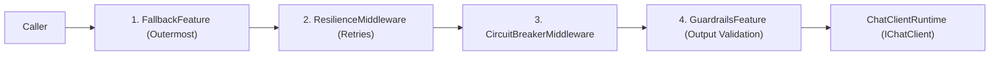

# Guardrails, Retries, Fallbacks & Dead-Letter Queues

Production AI systems must validate model outputs before they reach users and recover gracefully from transient provider outages or unhandled exceptions. MyAgents Community provides a layered defense pipeline via `GuardrailsFeature`, `ResilienceMiddleware`, and `FallbackFeature`.

## Defense-in-Depth Pipeline Ordering

When composing resilience and safety features on an `AgentDefinition`, order them from outermost to innermost:



---

## 1. Content-Safety Output Guardrails (`GuardrailsFeature`)

`GuardrailsFeature` attaches `GuardrailMiddleware` to evaluate every turn's output against an ordered list of `IGuardrailPolicy` implementations. If any policy returns a `GuardrailViolation`, the violating output is replaced outright with `violation.ReplacementMessage` (never leaking partial violating content, even on streaming calls).

### Built-in Guardrail Policies
- **`EmptyResponseGuardrailPolicy`**: Flags turns whose output is empty or whitespace-only (enabled by default in `new GuardrailsFeature()`).
- **`MaxLengthGuardrailPolicy(maxLength)`**: Flags turns whose total character length exceeds `maxLength`.
- **`BlocklistGuardrailPolicy(blockedPhrases)`**: Case-insensitive substring check against prohibited phrases, secrets, or competitor names.

```csharp
using MyAgents.Agents;
using MyAgents.Core;

var definition = new AgentDefinition("customer-facing-agent", [
    new GuardrailsFeature(
        new EmptyResponseGuardrailPolicy(),
        new MaxLengthGuardrailPolicy(maxLength: 4000),
        new BlocklistGuardrailPolicy(["INTERNAL_ONLY", "CONFIDENTIAL_PROJECT_X"]))
]);
```

### Custom `IGuardrailPolicy`

Implement `IGuardrailPolicy` for custom PII redaction, regex validation, or moderation checks:

```csharp
using MyAgents.Core;

public sealed class NoCreditCardGuardrailPolicy : IGuardrailPolicy
{
    public ValueTask<GuardrailViolation?> EvaluateAsync(
        IReadOnlyList<AgentMessage> output,
        CancellationToken cancellationToken = default)
    {
        foreach (var message in output)
        {
            if (message.Content is not null && message.Content.Contains("4111-", StringComparison.Ordinal))
            {
                return ValueTask.FromResult<GuardrailViolation?>(new GuardrailViolation(
                    PolicyName: nameof(NoCreditCardGuardrailPolicy),
                    Reason: "Output contained a masked or raw payment card pattern.",
                    ReplacementMessage: "I cannot display payment card numbers."));
            }
        }

        return ValueTask.FromResult<GuardrailViolation?>(null);
    }
}
```

---

## 2. Transient Retry Middleware (`ResilienceMiddleware`)

`ResilienceMiddleware` uses `ITransientErrorClassifier` (`DefaultTransientErrorClassifier`) to retry transient network or HTTP rate-limit failures with exponential backoff:

```csharp
using MyAgents.Core;

var resilience = new ResilienceMiddleware(
    classifier: new DefaultTransientErrorClassifier(),
    maxRetries: 3,
    baseDelay: TimeSpan.FromMilliseconds(500));
```

---

## 3. Graceful Fallbacks & Dead-Letter Queues (`FallbackFeature`)

When all retries are exhausted or an unrecoverable exception occurs, `FallbackFeature` (`FallbackMiddleware`) catches the exception and invokes an `IFallbackPolicy` so the caller receives a controlled response while failed turns are captured for inspection:

### Static Fallback (`StaticFallbackPolicy`)

```csharp
using MyAgents.Agents;
using MyAgents.Core;

var fallback = new FallbackFeature(
    new StaticFallbackPolicy("The assistant is temporarily unavailable. Please try again shortly."));
```

### Dead-Letter Queue Capture (`DeadLetterFallbackPolicy`)

Use `DeadLetterFallbackPolicy` with `IDeadLetterQueue` (`InMemoryDeadLetterQueue` or your own persistent queue) to record failed turn messages, session IDs, timestamps, and exceptions for alerting or replay:

```csharp
using MyAgents.Agents;
using MyAgents.Core;

var deadLetterQueue = new InMemoryDeadLetterQueue();

var definition = new AgentDefinition("resilient-support-agent", [
    new FallbackFeature(new DeadLetterFallbackPolicy(
        queue: deadLetterQueue,
        fallbackMessage: "We recorded your request and an engineer will follow up.")),
    new GuardrailsFeature()
]);

// Inspect captured dead letters for alerting or replay
foreach (DeadLetter item in deadLetterQueue.Items)
{
    Console.WriteLine($"Failed session {item.SessionId} at {item.FailedAt:O}: {item.Exception.Message}");
}
```
