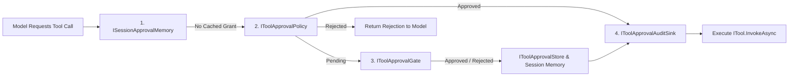

# Tool Approval, Gates & Audit Trails

When AI agents execute tools that mutate production state, run shell commands, or call external APIs, granular governance is essential. MyAgents Community provides a multi-stage tool approval pipeline built into `MyAgents.Core`.

## The Tool Approval Pipeline

Every tool call requested by a model is evaluated by `ToolApprovalEvaluator` before the tool handler runs:



---

## 1. Rule-Based Approval Policies (`RuleBasedToolApprovalPolicy`)

Configure allowlists, denylists, regex argument rules, and human-approval requirements using `RuleBasedToolApprovalPolicy`:

```csharp
using System.Text.RegularExpressions;
using Microsoft.Extensions.DependencyInjection;
using MyAgents.Core;

var policy = new RuleBasedToolApprovalPolicy()
    // 1. Safe read-only tools execute automatically
    .AllowTool("get_current_utc_time", reason: "Read-only clock tool")
    .AllowTool("search_knowledge_base", reason: "Read-only RAG search")

    // 2. Block dangerous arguments using regex inspection
    .AddArgumentPatternRule(
        toolPattern: "execute_sql",
        argumentRegex: new Regex(@"\b(DROP|DELETE|TRUNCATE|ALTER)\b", RegexOptions.IgnoreCase),
        decision: ToolApprovalDecision.Reject(decidedBy: "security-policy", reason: "Destructive SQL is prohibited."))

    // 3. Sensitive tools pause for interactive gate approval (returns ToolApprovalStatus.Pending)
    .RequireApprovalForTool("deploy_production", reason: "Production deployment requires operator sign-off")

    // 4. Custom predicate rule
    .AddRule(request => request.ToolName.StartsWith("internal_", StringComparison.Ordinal)
        ? ToolApprovalDecision.Reject("policy", "Internal tools are disabled.")
        : null)

    // 5. Reject any other unknown tool by default
    .SetDefaultDecision(ToolApprovalDecision.Reject(
        decidedBy: "default-policy",
        reason: "Tool is not in the approved allowlist."));

services.AddSingleton<IToolApprovalPolicy>(policy);
```

Other built-in policies include:
- `AllowAllToolApprovalPolicy`: Approves all tool calls (default when no policy is registered).
- `RequireApprovalPolicy`: Marks every tool call as `Pending` so an `IToolApprovalGate` is always consulted.

---

## 2. Human-in-the-Loop Approval Gates (`IToolApprovalGate`)

When a policy returns `ToolApprovalStatus.Pending`, `ToolApprovalEvaluator` invokes the registered `IToolApprovalGate` (`EvaluateOrPromptAsync`):

### Built-in Gates

1. **`ConsolePromptApprovalGate`**: Interactive CLI prompt for console applications.
   ```csharp
   services.AddSingleton<IToolApprovalGate>(
       new ConsolePromptApprovalGate(Console.In, Console.Out, autoApproveNonInteractive: false));
   ```
2. **`CallbackToolApprovalGate`**: Delegate-based gate for custom webhooks or UI dialogs.
   ```csharp
   var gate = new CallbackToolApprovalGate(async (request, pendingDecision, ct) =>
   {
       bool approved = await mySlackNotifier.AskSupervisorAsync(request.ToolName, request.ArgumentsJson, ct);
       return approved
           ? ToolApprovalDecision.Approve(
               decidedBy: "supervisor@acme.com",
               reason: "Approved via Slack",
               scope: ApprovalScope.SessionTool)
           : ToolApprovalDecision.Reject(
               decidedBy: "supervisor@acme.com",
               reason: "Denied via Slack");
   });
   services.AddSingleton<IToolApprovalGate>(gate);
   ```
3. **`AsyncSignalApprovalGate`**: Asynchronous signal queue where external HTTP endpoints can inspect `gate.PendingRequests` and complete decisions via `gate.TrySubmitDecision(approvalId, decision)`.

---

## 3. Session Approval Scopes & Audit Sinks

When approving a tool call, you can specify an `ApprovalScope` so the human operator is not prompted repeatedly during the same session:
- `ApprovalScope.Once`: Valid only for this single tool invocation.
- `ApprovalScope.SessionCall`: Remembers approval for the same tool **and identical JSON arguments** within the session.
- `ApprovalScope.SessionTool`: Remembers approval for all future calls to the same tool within the session.
- `ApprovalScope.SessionAlways`: Approves all subsequent tool calls in the session.

Register `ISessionApprovalMemory`, `IToolApprovalStore`, and `IToolApprovalAuditSink` in DI to persist and inspect decisions:

```csharp
var sessionMemory = new InMemorySessionApprovalMemory();
var approvalStore = new InMemoryToolApprovalStore();
var auditSink = new InMemoryToolApprovalAuditSink();

services.AddSingleton<ISessionApprovalMemory>(sessionMemory);
services.AddSingleton<IToolApprovalStore>(approvalStore);
services.AddSingleton<IToolApprovalAuditSink>(auditSink);

// After running turns, inspect the immutable audit log:
IReadOnlyList<ToolApprovalAuditRecord> auditRecords = await auditSink.ListAllAsync();
foreach (var record in auditRecords)
{
    Console.WriteLine($"{record.Timestamp:O} | {record.ToolName} | {record.Decision.Status} by {record.Decision.DecidedBy} ({record.GateType})");
}
```
