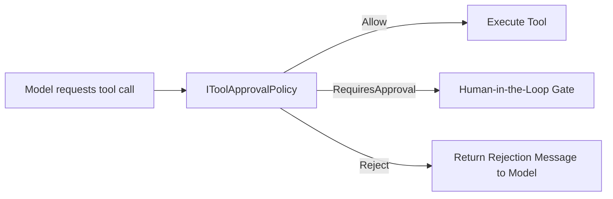

# Tool Approval & Allowlisting

When AI agents execute tools that write to production databases, send emails, or charge credit cards, safety policies are required to prevent unintended actions.

## The `IToolApprovalPolicy` Interface

Every tool call generated by a model passes through an `IToolApprovalPolicy` before the tool handler is executed:



---

## 1. Configuring Rule-Based Allowlisting

You can configure granular allowlists and rejection rules using `RuleBasedToolApprovalPolicy`:

```csharp
using MyAgents.Core.Approvals;

var policy = new RuleBasedToolApprovalPolicy()
    // 1. Safe read-only tools execute without prompting
    .AllowTool("get_current_time")
    .AllowTool("search_knowledge_base")
    .AllowToolPrefix("read_")

    // 2. Sensitive tools require human supervisor approval
    .RequireApproval("delete_customer_account")
    .RequireApproval("execute_wire_transfer")

    // 3. Reject any unknown tool by default
    .SetDefaultDecision(ToolApprovalDecision.Reject(
        reason: "policy_violation",
        message: "Tool is not in the approved corporate allowlist."));
```

---

## 2. Implementing Human-in-the-Loop Gates

When a tool decision is `RequiresApproval`, the runtime invokes an `IToolApprovalGate` to prompt a human operator or query an external authorization webhook:

```csharp
public sealed class ConsoleApprovalGate : IToolApprovalGate
{
    public ValueTask<bool> RequestApprovalAsync(
        ToolApprovalRequest request,
        CancellationToken cancellationToken)
    {
        Console.ForegroundColor = ConsoleColor.Yellow;
        Console.WriteLine($"\n[SECURITY ALERT] Agent wants to call: {request.ToolName}");
        Console.WriteLine($"Arguments: {request.ArgumentsJson}");
        Console.Write("Approve execution? (y/n): ");
        Console.ResetColor();

        var response = Console.ReadLine();
        return ValueTask.FromResult(string.Equals(response?.Trim(), "y", StringComparison.OrdinalIgnoreCase));
    }
}
```

Register the gate in your agent definition:

```csharp
var definition = new AgentDefinition("guarded-agent", [
    new ToolApprovalFeature(policy, new ConsoleApprovalGate())
]);
```
