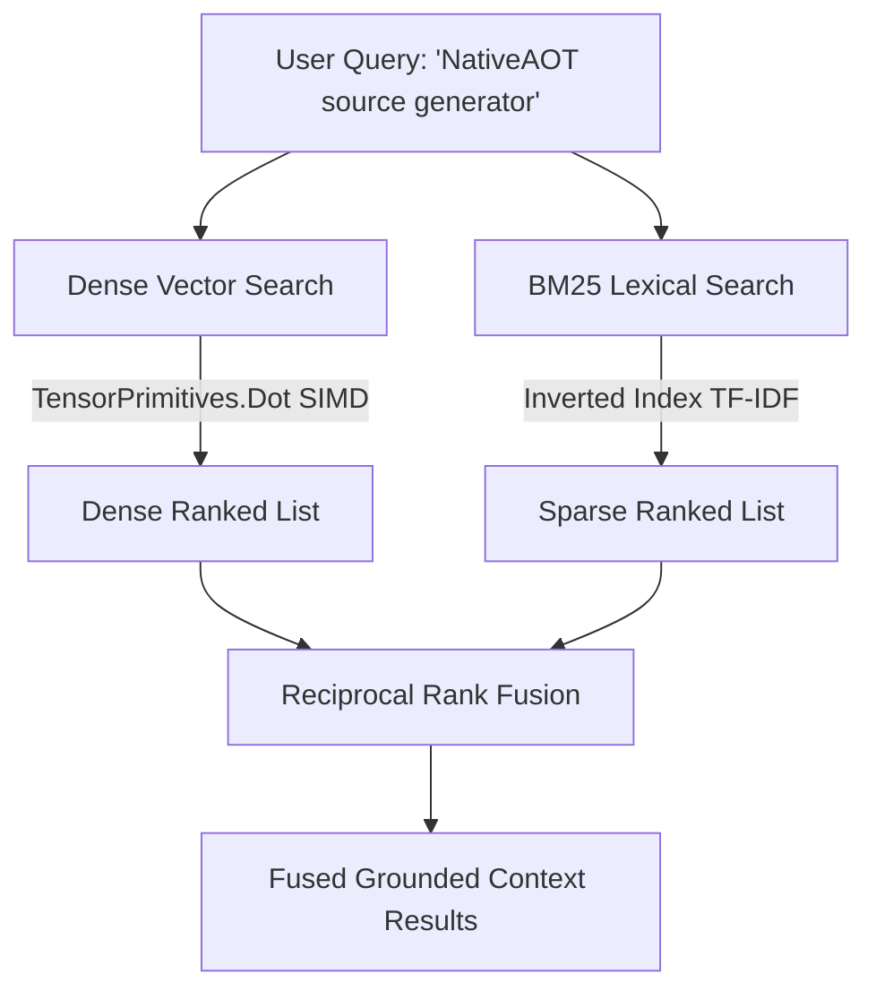

# Hybrid RAG & Memory Retrieval

`MyAgents.Memory` delivers an enterprise-grade retrieval-augmented generation (RAG) system with zero external vector database dependencies.

## Why Hybrid Retrieval?

Pure vector search (dense embeddings) excels at semantic understanding and conceptual matches, but struggles with exact identifiers, SKU numbers, code keywords, or rare terminology. Pure keyword search (BM25) excels at exact matches but lacks semantic awareness.

MyAgents Community combines both using **Reciprocal Rank Fusion (RRF)**:



---

## 1. Configuring Hybrid Memory

```csharp
using Microsoft.Extensions.AI;
using Microsoft.Extensions.DependencyInjection;
using MyAgents.Memory;

var services = new ServiceCollection();

// Register your embedding generator (e.g. OpenAI or local ONNX)
services.AddSingleton<IEmbeddingGenerator<string, Embedding<float>>>(embeddingGenerator);

// Register in-memory or SQLite vector store
services.AddSingleton<IMemoryStore, SqliteMemoryStore>(sp => 
    new SqliteMemoryStore("vectors.db", sp.GetRequiredService<IEmbeddingGenerator<string, Embedding<float>>>()));

// Add Hybrid Memory Retrieval with BM25 indexing
services.AddHybridMemoryRetrieval();

var provider = services.BuildServiceProvider();
var retriever = provider.GetRequiredService<IHybridMemoryRetriever>();
```

---

## 2. Executing a Hybrid Query

```csharp
var query = new HybridMemoryQuery(
    QueryText: "NativeAOT source generator",
    MaxResults: 5,
    RankingMode: HybridRankingMode.ReciprocalRankFusion,
    DenseWeight: 0.5,
    SparseWeight: 0.5,
    RrfK: 60
);

IReadOnlyList<HybridMemorySearchResult> results = await retriever.SearchHybridAsync(
    ns: "technical-docs",
    query: query,
    cancellationToken: cancellationToken);

foreach (var hit in results)
{
    Console.WriteLine($"[Score: {hit.FusedScore:F4}] {hit.Entry.Key}: {hit.Entry.Content}");
}
```

---

## 3. Grounded Citation Feature

Inject retrieved context directly into the agent prompt with automatic citation markers (`[1]`, `[2]`):

```csharp
var ragOptions = new RetrievalAugmentationOptions
{
    MaxResults = 5,
    MaxContextTokens = 2000,
    AdjacentChunkWindow = 1,
    AppendCitationReferences = true
};

var definition = new AgentDefinition("grounded-assistant", [
    new RetrievalAugmentationFeature(retriever, ragOptions)
]);
```
