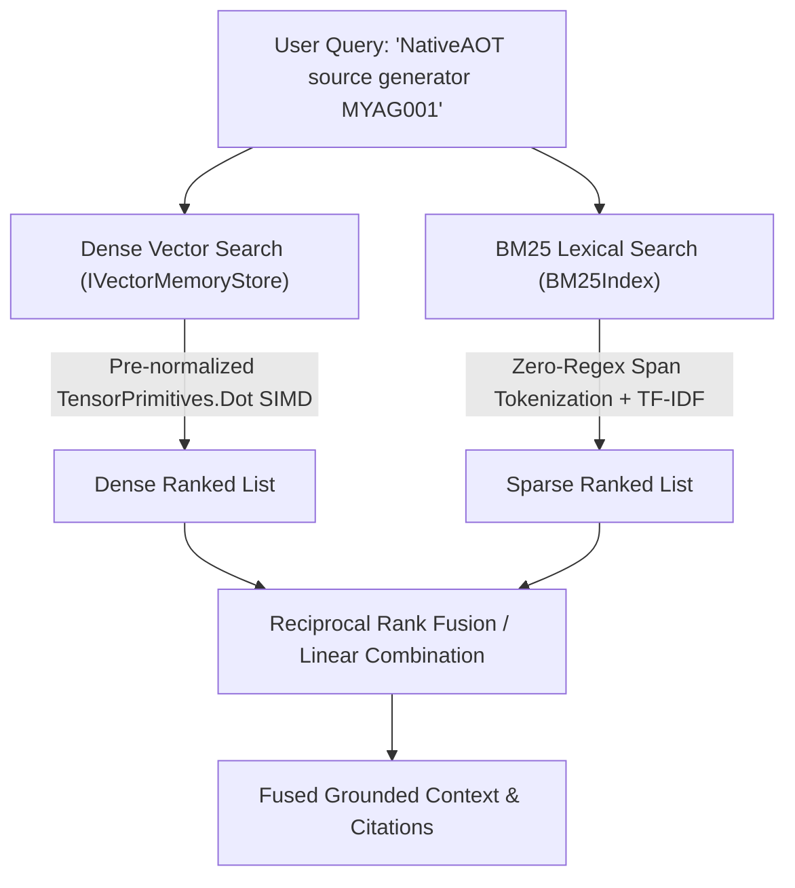

# Hybrid RAG & Vector Memory Stores

`MyAgents.Memory` delivers an enterprise-grade retrieval-augmented generation (RAG) and memory system with **zero mandatory external database dependencies**, while also supporting persistent SQLite storage and `Microsoft.Extensions.VectorData` providers.

## Why Hybrid Retrieval?

Pure vector search (dense embeddings) excels at semantic similarity and conceptual queries, but can miss exact product SKUs, error codes, C# type names, or rare identifiers. Pure keyword search (BM25) excels at exact token matching but lacks semantic understanding.

MyAgents Community combines both using **Reciprocal Rank Fusion (RRF)** or **Weighted Linear Combination**:



---

## 1. Choosing a Memory Store

`MyAgents.Memory` ships with three `IVectorMemoryStore` implementations that all support `IMemoryStoreChangeNotifier` (automatically keeping the `BM25Index` synchronized on writes and deletes) and SHA-256 content-hash deduplication:

### Option A: Durable SQLite Vector Store (`SqliteMemoryStore`)
Persists entries, JSON metadata, and binary float embeddings in WAL-mode SQLite while executing SIMD `TensorPrimitives.Dot` similarity in memory:

```csharp
using Microsoft.Extensions.AI;
using Microsoft.Extensions.DependencyInjection;
using MyAgents.Memory;

var services = new ServiceCollection();
services.AddSingleton<IEmbeddingGenerator<string, Embedding<float>>>(embeddingGenerator);

// Registers SqliteMemoryStore as IMemoryStore + IVectorMemoryStore and adds HybridMemoryRetriever
services.AddSqliteMemoryStore("knowledge.db");
```

### Option B: In-Memory SIMD Vector Store with Snapshots (`VectorMemoryStore`)
High-speed in-memory vector store with binary stream/file snapshot persistence:

```csharp
var vectorStore = new VectorMemoryStore(embeddingGenerator);

// Save and restore binary snapshots for fast warm starts
await vectorStore.SaveToFileAsync("vectors.snapshot", cancellationToken);
int loadedCount = await vectorStore.LoadFromFileAsync("vectors.snapshot", cancellationToken);
```

### Option C: `Microsoft.Extensions.VectorData` Bridge (`VectorDataMemoryStore`)
Bridges any `VectorStoreCollection<string, VectorDataMemoryRecord>` from the `Microsoft.Extensions.VectorData` ecosystem:

```csharp
services.AddVectorDataMemoryStore(vectorStoreCollection);
```

### Content-Hash Embedding Caching (`CachingEmbeddingGenerator`)
Wrap any `IEmbeddingGenerator<string, Embedding<float>>` in `CachingEmbeddingGenerator` to avoid re-computing embeddings for repeated queries or unchanged chunks:

```csharp
var cachedEmbedder = new CachingEmbeddingGenerator(innerEmbeddingGenerator, maxCacheEntries: 4096);
Console.WriteLine($"Cache Hits: {cachedEmbedder.CacheHits}, Misses: {cachedEmbedder.CacheMisses}");
```

---

## 2. Executing a Hybrid Search Query

```csharp
var retriever = provider.GetRequiredService<IHybridMemoryRetriever>();

var query = new HybridMemoryQuery(
    QueryText: "NativeAOT source generator",
    MaxResults: 5,
    DenseWeight: 0.5,
    SparseWeight: 0.5,
    RrfK: 60,
    RankingMode: HybridRankingMode.ReciprocalRankFusion,
    MinScore: 0.0,
    MetadataFilters: new Dictionary<string, string> { ["category"] = "tools" });

IReadOnlyList<HybridMemorySearchResult> results = await retriever.SearchHybridAsync(
    ns: "technical-docs",
    query: query,
    cancellationToken: cancellationToken);

foreach (var hit in results)
{
    Console.WriteLine($"[Fused: {hit.FusedScore:F4} | DenseRank: {hit.DenseRank} | SparseRank: {hit.SparseRank}] {hit.Entry.Key}");
}
```

---

## 3. Automatic Context Injection & Grounded Citations (`RetrievalAugmentationFeature`)

Register `RetrievalAugmentationFeature` on an agent to automatically retrieve relevant chunks before each turn, expand adjacent neighbor chunks, enforce token budgets, and verify citation grounding (`[1]`, `[2]`) on the assistant's response:

```csharp
using MyAgents.Core;
using MyAgents.Memory;

var ragOptions = new RetrievalAugmentationOptions(
    Namespace: "technical-docs",
    MaxResults: 5,
    MinScore: 0.1,
    MaxContextTokens: 2000,
    DeduplicateAcrossTurns: true,
    AdjacentChunkWindow: 1,
    AppendCitationReferences: true,
    OnCitationsEvaluated: grounding =>
    {
        Console.WriteLine($"Grounded: {grounding.IsGrounded}, Cited sources: {grounding.CitedSources.Count}");
    });

var definition = new AgentDefinition("grounded-assistant", [
    new RetrievalAugmentationFeature(ragOptions)
]);
```

When `AppendCitationReferences: true` is enabled and the model cites `[1]` in its answer, `RetrievalAugmentationFeature` automatically appends a formatted `References:` footer with the document title and source provenance.
