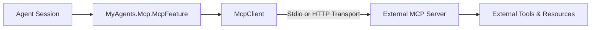

# Model Context Protocol (MCP) Integration

The `MyAgents.Mcp` package provides first-class integration with the [Model Context Protocol (MCP)](https://modelcontextprotocol.io), allowing your agents to interact with external tools and resources running over standard I/O (stdio) or HTTP/Server-Sent Events (SSE).

## Installation

```bash
dotnet add package MyAgents.Mcp
```

## How MCP Works with MyAgents

When you register an `McpFeature` on an `AgentDefinition`, the runtime connects to the target MCP server, queries its tool catalog, and translates them into `ITool` implementations:



---

## 1. Local Process MCP Server (Stdio)

To connect to a local MCP server running as a sub-process (e.g. SQLite, GitHub, or Filesystem MCP servers):

```csharp
using ModelContextProtocol.Client;
using MyAgents.Core;
using MyAgents.Mcp;

// Configure stdio transport to launch a local server process
var transport = new StdioClientTransport(new StdioClientTransportOptions
{
    Command = "npx",
    Arguments = ["-y", "@modelcontextprotocol/server-sqlite", "--db-path", "analytics.db"]
});

var mcpFeature = new McpFeature(transport, new McpFeatureOptions
{
    ImportPrompts = true,
    ExposeResourceTools = true
});

var definition = new AgentDefinition("data-agent", [mcpFeature]);
```

## 2. Remote MCP Server (HTTP / SSE)

To connect to a remote or containerized MCP server over HTTP / SSE:

```csharp
using ModelContextProtocol.Client;
using MyAgents.Mcp;

var httpTransport = new HttpClientTransport(new HttpClientTransportOptions
{
    Endpoint = new Uri("https://mcp.internal.corp/sse")
});

var mcpFeature = new McpFeature(httpTransport);
var definition = new AgentDefinition("cloud-agent", [mcpFeature]);
```

---

## Multi-Server Aggregation

If your agent requires tools from multiple different MCP servers simultaneously (e.g., both a GitHub MCP server and a Database MCP server), use `McpMultiServerFeature`:

```csharp
using MyAgents.Mcp;

var multiServer = new McpMultiServerFeature();

multiServer.AddServer("db", new StdioClientTransport(new StdioClientTransportOptions
{
    Command = "npx",
    Arguments = ["-y", "@modelcontextprotocol/server-sqlite", "app.db"]
}));

multiServer.AddServer("filesystem", new StdioClientTransport(new StdioClientTransportOptions
{
    Command = "npx",
    Arguments = ["-y", "@modelcontextprotocol/server-filesystem", "/allowed/workspace"]
}));

var definition = new AgentDefinition("poly-agent", [multiServer]);
```

## Lifecycle & Session Ownership

The underlying MCP connection and child process resources are owned by the active `IAgentSession`. When `await session.DisposeAsync()` is called at the end of a conversation, all child processes and connections are gracefully terminated.
