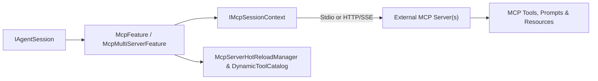

# Model Context Protocol (MCP) Integration

The `MyAgents.Mcp` package provides first-class integration with the [Model Context Protocol (MCP)](https://modelcontextprotocol.io), allowing your agents to discover and invoke external tools, import server prompts, read external resources, hot-reload MCP connections at runtime, and discover local skill packs.

## Installation

```bash
dotnet add package MyAgents.Mcp
```

## How MCP Works with MyAgents

When you register `McpFeature` or `McpMultiServerFeature` on an `AgentDefinition`, the feature connects to the configured MCP transport(s) during `CreateSessionAsync`, imports tools as `ITool` adapters, and optionally registers MCP prompts and resource-reading tools:



---

## 1. Single MCP Server (`McpFeature`)

### Local Process MCP Server (Stdio)

```csharp
using ModelContextProtocol.Client;
using MyAgents.Core;
using MyAgents.Mcp;

var transport = new StdioClientTransport(new StdioClientTransportOptions
{
    Command = "npx",
    Arguments = ["-y", "@modelcontextprotocol/server-sqlite", "--db-path", "analytics.db"]
});

var mcpFeature = new McpFeature(
    transport,
    new McpFeatureOptions(ImportPrompts: true, ExposeResourceTools: true));

var definition = new AgentDefinition("data-agent", [mcpFeature]);

// Use CreateSessionAsync when features perform async I/O during assembly
var factory = (DefaultAgentSessionFactory)serviceProvider.GetRequiredService<IAgentSessionFactory>();
await using var session = await factory.CreateSessionAsync("mcp-session-1", definition, cancellationToken);
```

### Remote MCP Server (HTTP / SSE)

```csharp
using ModelContextProtocol.Client;
using MyAgents.Mcp;

var httpTransport = new HttpClientTransport(new HttpClientTransportOptions
{
    Endpoint = new Uri("https://mcp.internal.corp/sse")
});

var mcpFeature = new McpFeature(httpTransport);
```

---

## 2. Multi-Server Aggregation (`McpMultiServerFeature`)

When an agent needs tools from multiple MCP servers simultaneously, use `McpMultiServerFeature` with `McpMultiServerFeature.ServerConfig`:

```csharp
using ModelContextProtocol.Client;
using MyAgents.Core;
using MyAgents.Mcp;

var servers = new[]
{
    new McpMultiServerFeature.ServerConfig(
        Name: "db",
        Transport: new StdioClientTransport(new StdioClientTransportOptions
        {
            Command = "npx",
            Arguments = ["-y", "@modelcontextprotocol/server-sqlite", "app.db"]
        }),
        EnableDynamicRefresh: true),

    new McpMultiServerFeature.ServerConfig(
        Name: "filesystem",
        Transport: new StdioClientTransport(new StdioClientTransportOptions
        {
            Command = "npx",
            Arguments = ["-y", "@modelcontextprotocol/server-filesystem", "/workspace"]
        }),
        EnableDynamicRefresh: true)
};

var options = new McpMultiServerFeatureOptions(
    ImportPrompts: true,
    ExposeResourceTools: true,
    AllowedToolNames: null); // Or pass a HashSet<string> to allowlist specific tools

var multiServerFeature = new McpMultiServerFeature(
    servers: servers,
    options: options,
    refreshInterval: TimeSpan.FromMinutes(5));

multiServerFeature.ToolListChanged += (_, args) =>
{
    Console.WriteLine($"MCP server '{args.ServerName}' updated its tool list ({args.Tools.Count} tools).");
};

var definition = new AgentDefinition("poly-agent", [multiServerFeature]);
```

---

## 3. Dynamic Hot-Reload & Skill Discovery (`McpHotReloadFeature`)

For long-running sessions where MCP servers are added, removed, or reloaded on the fly, use `DynamicToolCatalog`, `McpServerHotReloadManager`, and `McpHotReloadFeature`:

```csharp
using MyAgents.Core;
using MyAgents.Mcp;

var catalog = new DynamicToolCatalog();
await using var hotReloadManager = new McpServerHotReloadManager(catalog);
var skillDiscovery = new McpSkillDiscoveryService();

// Register an MCP server dynamically at runtime
await hotReloadManager.RegisterServerAsync("github", githubTransport, cancellationToken);

// Trigger a hot-reload of a specific server or all servers
McpServerReloadResult reloadResult = await hotReloadManager.ReloadServerAsync("github", cancellationToken);
Console.WriteLine($"Reloaded {reloadResult.ServerName}: {reloadResult.NewToolCount} tools active.");

// Equip the agent with hot-reload and skill discovery tools:
// - list_active_mcp_servers
// - reload_mcp_servers
// - discover_skills
var definition = new AgentDefinition("dynamic-agent", [
    new McpHotReloadFeature(hotReloadManager, catalog, skillDiscovery)
]);
```

### Discovering Local Skill Manifests (`ISkillDiscoveryService`)

`McpSkillDiscoveryService` scans a directory for skill manifests (`SKILL.md` or JSON skill definitions) and returns structured `DiscoveredSkill` metadata (`Name`, `Description`, `SourcePath`, `Tags`):

```csharp
IReadOnlyList<DiscoveredSkill> skills = await skillDiscovery.DiscoverSkillsAsync(
    directoryPath: ".agents/skills",
    cancellationToken: cancellationToken);

foreach (var skill in skills)
{
    Console.WriteLine($"Skill: {skill.Name} - {skill.Description} ({string.Join(", ", skill.Tags)})");
}
```
