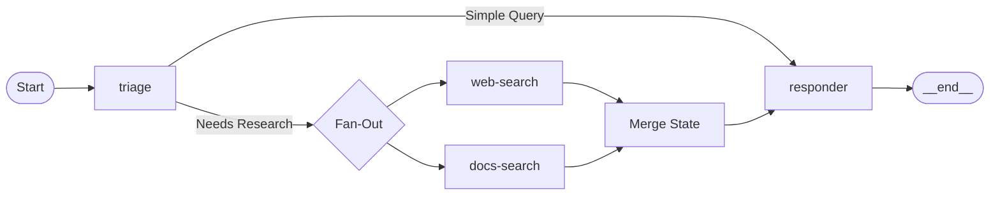

# Agent State Graphs (`AgentGraph<TState>`)

For multi-step workflows that require explicit control flow—branching conditions, loops, parallel fan-out/fan-in, dynamic map-reduce (`SendPacket<TState>`), nested subgraphs, and time-travel state snapshots—`MyAgents.Core.Workflows` provides `AgentGraph<TState>`.

## Architecture Overview



---

## 1. Building and Running a State Graph

An `AgentGraph<TState>` operates over an immutable or record state `TState` and a state merge function `Func<TState, TState, TState>` used when joining parallel branches:

```csharp
using MyAgents.Core;
using MyAgents.Core.Workflows;

public sealed record ResearchState(
    string Topic,
    int QualityScore = 0,
    string Draft = "",
    IReadOnlyList<string>? Notes = null);

var historyStore = new InMemoryGraphHistoryStore(maxSnapshotsPerSession: 100);

var graph = new AgentGraph<ResearchState>(
    sessionFactory: sessionFactory,
    agentDefinitions: [researcherDef, writerDef, criticDef],
    merge: (current, branch) => branch with
    {
        Notes = [..(current.Notes ?? []), ..(branch.Notes ?? [])]
    },
    maxIterations: 20,
    historyStore: historyStore);

// 1. Add nodes (each node receives the current TState and an IAgentSession)
graph.AddNode("researcher", async (state, session, ct) =>
{
    var turn = await session.InvokeAsync([AgentMessage.FromText("user", $"Research: {state.Topic}")], ct);
    return state with { Notes = [turn.Output[0].Content] };
});

graph.AddNode("writer", async (state, session, ct) =>
{
    var notes = string.Join("\n", state.Notes ?? []);
    var turn = await session.InvokeAsync([AgentMessage.FromText("user", $"Write draft from notes:\n{notes}")], ct);
    return state with { Draft = turn.Output[0].Content, QualityScore = state.QualityScore + 50 };
});

// 2. Connect edges and conditional routing
graph.AddEdge("researcher", "writer");
graph.AddConditionalEdge("writer", state =>
    state.QualityScore >= 80
        ? AgentGraph<ResearchState>.End
        : "writer"); // Loop back to refine until QualityScore >= 80

// 3. Execute the graph
GraphRunResult<ResearchState> result = await graph.RunAsync(
    startNode: "researcher",
    initialState: new ResearchState(Topic: ".NET 10 NativeAOT"),
    initialMessages: [],
    graphSessionId: "graph-session-1",
    cancellationToken: cancellationToken);

Console.WriteLine($"Completed ({result.Reason}) in {result.IterationsExecuted} iterations.");
Console.WriteLine(result.FinalState.Draft);
```

---

## 2. Parallel Fan-Out & Dynamic Map-Reduce (`SendPacket<TState>`)

### Static Parallel Fan-Out (`AddFanOutEdge`)

Execute multiple nodes concurrently and merge their resulting states using the graph's `merge` function:

```csharp
graph.AddFanOutEdge("triage", ["web-search", "docs-search"]);
graph.AddEdge("web-search", "synthesizer");
graph.AddEdge("docs-search", "synthesizer");
```

### Dynamic Map-Reduce (`AddSendEdge`)

When the number of parallel tasks is only known at runtime (for example, spawning one node execution per sub-question generated by a planner), use `AddSendEdge` with `SendPacket<TState>`:

```csharp
graph.AddSendEdge("planner", state =>
{
    // Dynamically dispatch one "worker" execution per topic with customized state
    return state.SubTopics
        .Select(subTopic => new SendPacket<ResearchState>("worker", state with { Topic = subTopic }))
        .ToList();
});
```

---

## 3. Nested Subgraphs (`AddSubgraph`)

Compose modular graphs by embedding an `AgentGraph<TInnerState>` as a single node inside a parent `AgentGraph<TOuterState>`:

```csharp
graph.AddSubgraph(
    nodeName: "deep-verification",
    subgraph: verificationSubgraph,
    subgraphStartNode: "fact-check",
    mapIn: outerState => new VerificationState(outerState.Draft),
    mapOut: (outerState, innerState) => outerState with { QualityScore = innerState.VerifiedScore });
```

---

## 4. Streaming Graph Events & Exporting Diagrams

### Streaming Node Transitions (`RunStreamingAsync`)

```csharp
await foreach (GraphStreamEvent<ResearchState> evt in graph.RunStreamingAsync(
    startNode: "researcher",
    initialState: new ResearchState("Hybrid RAG"),
    initialMessages: [],
    graphSessionId: "stream-session-1",
    cancellationToken: cancellationToken))
{
    Console.WriteLine($"Node '{evt.NodeName}' completed. IsFinal: {evt.IsFinal}");
}
```

### Exporting Mermaid and Graphviz DOT Diagrams

```csharp
string mermaidDiagram = graph.ToMermaid(direction: "TD");
string dotGraph = graph.ToDot(graphName: "ResearchPipeline");
```

---

## 5. Snapshot Time-Travel & Replay (`IGraphHistoryStore`)

When an `IGraphHistoryStore` (`InMemoryGraphHistoryStore` or `FileSystemGraphHistoryStore`) is attached to `AgentGraph<TState>`, every node transition saves a `GraphSnapshot`. You can inspect snapshots and resume or fork execution from any historical snapshot:

```csharp
IReadOnlyList<GraphSnapshot> snapshots = await historyStore.ListSnapshotsAsync("graph-session-1", cancellationToken);

// Resume or branch from an earlier snapshot into a new session
GraphSnapshot checkpoint = snapshots[0];
GraphRunResult<ResearchState> replayed = await graph.ResumeFromSnapshotAsync(
    snapshotId: checkpoint.SnapshotId,
    startNode: checkpoint.NodeName,
    newSessionId: "graph-session-1-branch",
    cancellationToken: cancellationToken);
```
