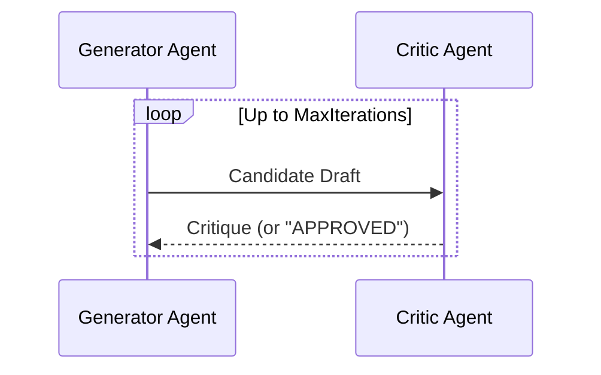

# Orchestration Patterns: Loops, Reflection, Consensus & Goals

`MyAgents.Core.Workflows` ships ready-to-use building blocks for higher-level agentic reasoning patterns: iterative `AgentLoop` reductions, planner-worker-synthesizer orchestration (`OrchestratorSteps`), generator-critic self-refinement (`ReflectionSteps`), multi-agent majority voting (`ConsensusSteps`), and dynamic goal prioritization (`GoalSteps` & `AdaptationSteps`).

---

## 1. Iterative Agent Loops (`AgentLoop` & `ITerminationCondition`)

`AgentLoop.RunAsync` repeatedly invokes an `IAgentSession`, reducing state across turns until an `ITerminationCondition` is satisfied or `maxTurns` is reached.

### Built-in Termination Conditions
- `MaxTurnsTermination(maxTurns)`
- `TextMentionTermination(phrase, StringComparison)`
- `TokenBudgetTermination(maxTokens)`
- Combinators: `ITerminationCondition.Any(...)` and `ITerminationCondition.All(...)`

```csharp
using MyAgents.Core;
using MyAgents.Core.Workflows;

var termination = ITerminationCondition.Any(
    new TextMentionTermination("TASK_COMPLETE"),
    new TokenBudgetTermination(maxTokens: 8000));

AgentLoopResult<int> loopResult = await AgentLoop.RunAsync(
    session: session,
    initialState: 0,
    initialMessages: [AgentMessage.FromText("user", "Iteratively refine the SQL schema until complete.")],
    reducer: (stepCount, turnResult) => stepCount + 1,
    termination: termination,
    maxTurns: 5,
    onTurnCompleted: (state, turn, idx) => Console.WriteLine($"Completed turn {idx}"),
    cancellationToken: cancellationToken);

Console.WriteLine($"Stopped because: {loopResult.Reason} after {loopResult.TurnsCompleted} turns.");
```

---

## 2. Generator-Critic Self-Refinement (`ReflectionSteps`)

`ReflectionSteps.RunAsync` pairs a **generator** agent with a **critic** agent in a feedback loop until the critic approves the candidate output (or `MaxIterations` is reached):



```csharp
using MyAgents.Core;
using MyAgents.Core.Workflows;

var options = new ReflectionOptions(
    GeneratorAgentName: "code-author",
    CriticAgentName: "security-reviewer",
    MaxIterations: 3,
    ApprovalPredicate: ReflectionSteps.ContainsApprovedCritique);

ReflectionResult reflection = await ReflectionSteps.RunAsync(
    session: workflowSession,
    options: options,
    initialMessages: [AgentMessage.FromText("user", "Write a JWT validation middleware in C#.")],
    cancellationToken: cancellationToken);

Console.WriteLine($"Approved: {reflection.Approved} in {reflection.IterationsCompleted} iteration(s).");
Console.WriteLine(reflection.FinalCandidate.Output[0].Content);
```

---

## 3. Planner-Worker-Synthesizer (`OrchestratorSteps`)

`OrchestratorSteps.RunAsync` asks a **planner** agent to decompose a complex objective into a structured `OrchestratorPlan` of steps, dispatches steps (sequentially or in parallel batches) to specialized **worker** agents, and invokes a **synthesizer** agent to produce the final answer:

```csharp
using MyAgents.Core;
using MyAgents.Core.Workflows;

var orchestratorOptions = new OrchestratorOptions(
    PlannerAgentName: "lead-planner",
    WorkerAgentNames: ["db-specialist", "api-specialist", "frontend-specialist"],
    SynthesizerAgentName: "tech-lead",
    MaxSteps: 6,
    MaxRepairAttempts: 2,
    AllowParallelExecution: true);

OrchestratorResult result = await OrchestratorSteps.RunAsync(
    session: workflowSession,
    options: orchestratorOptions,
    initialMessages: [AgentMessage.FromText("user", "Design an end-to-end audit logging feature.")],
    cancellationToken: cancellationToken);

Console.WriteLine($"Executed {result.StepResults.Count} planned steps.");
Console.WriteLine(result.FinalResult.Output[0].Content);
```

---

## 4. Multi-Agent Majority Voting (`ConsensusSteps`)

When high reliability is needed for classification or decision-making, `ConsensusSteps.RunMajorityVoteAsync` queries multiple agents in parallel, extracts each agent's discrete choice, and computes the majority winner (with optional tie-breaker):

```csharp
using MyAgents.Core;
using MyAgents.Core.Workflows;

ConsensusResult consensus = await ConsensusSteps.RunMajorityVoteAsync(
    session: workflowSession,
    agentNames: ["auditor-1", "auditor-2", "auditor-3"],
    messages: [AgentMessage.FromText("user", "Is this transaction fraudulent? Reply SAFE or FRAUD.")],
    choiceSelector: turn => turn.Output[0].Content.Trim().ToUpperInvariant(),
    tieBreaker: tied => tied[0],
    cancellationToken: cancellationToken);

Console.WriteLine($"Winning decision: {consensus.WinningChoice} (Tie broken: {consensus.TieBroken})");
```

---

## 5. Goal Prioritization & Runtime Adaptation (`GoalSteps` & `AdaptationSteps`)

For autonomous agents managing a backlog of goals and adapting to runtime outcomes or human feedback:
- **`GoalCollection` & `GoalSteps`**: Register `GoalDefinition` items with priorities (`Critical`, `High`, `Normal`, `Low`), transition statuses (`Ready`, `Active`, `Blocked`, `Completed`, `Failed`), and select the highest-scoring ready goal via `GoalSteps.SelectNextAsync(goals, policy)`.
- **`AdaptationSteps` & `DefaultAdaptationPolicy`**: Record `OutcomeRecord` and `FeedbackRecord` entries during execution and call `AdaptationSteps.EvaluateAsync(...)` to generate `AdaptationHint` prompt adjustments when outcome scores drop below threshold.
